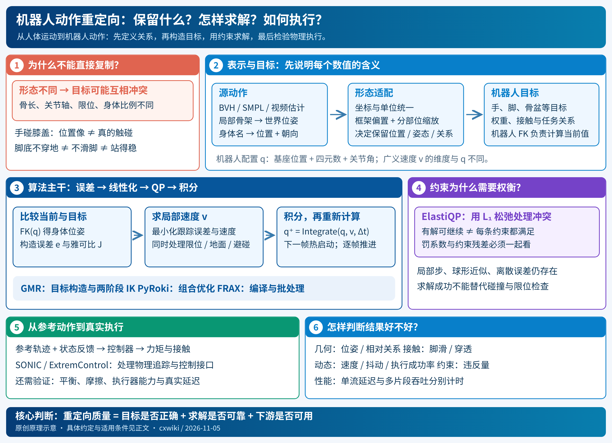
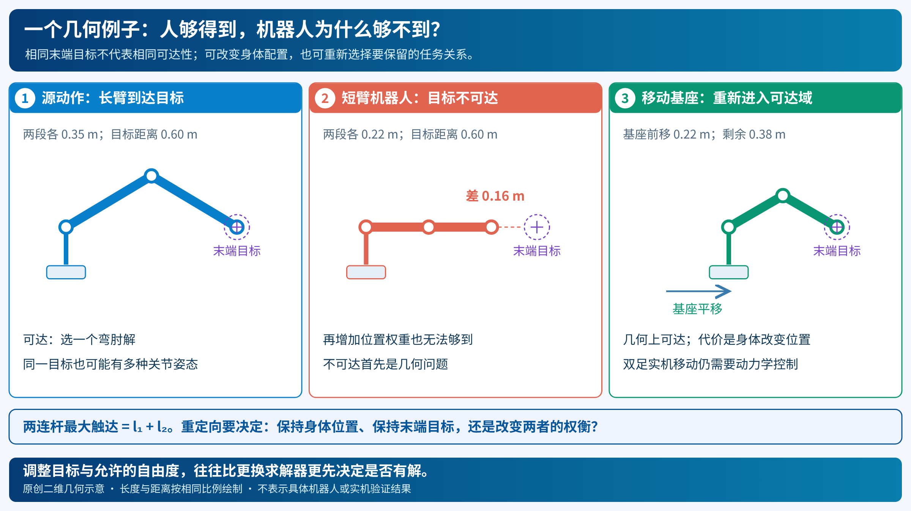
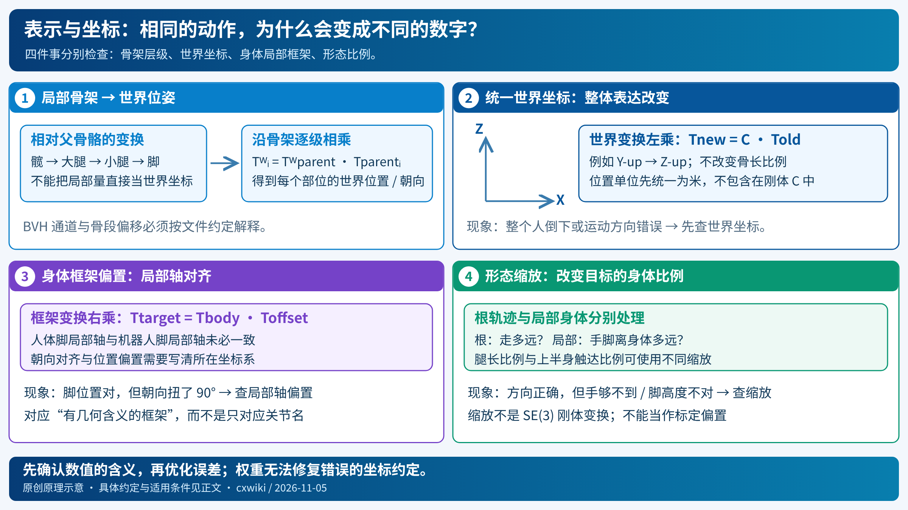
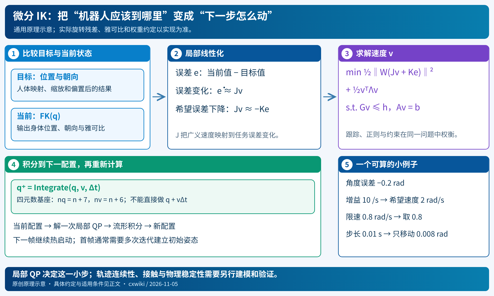
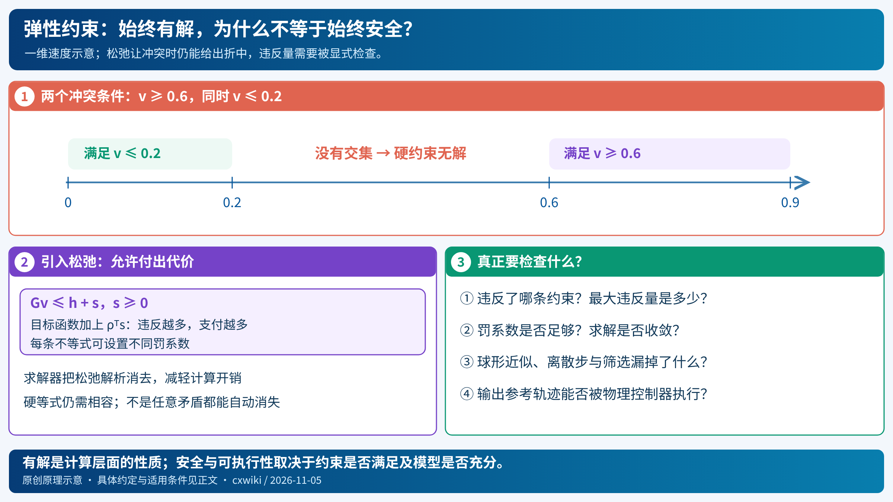
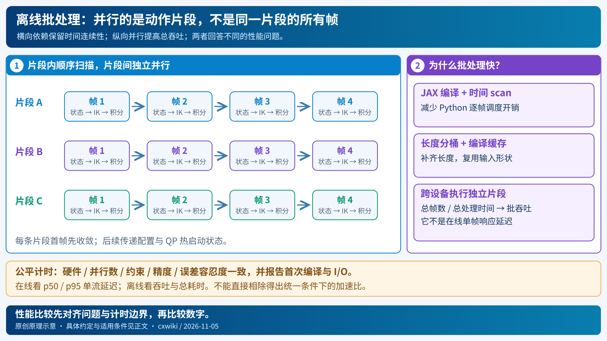

# 机器人动作重定向：从人体表示、约束 IK 到物理执行

一个人蹲下、伸手拿杯子，机器人应该怎样模仿？直接复制关节角通常行不通：人的肩、腕、脊柱和机器人的结构不同，四肢比例也不同。强求机器人每个身体部位都到达人的位置，目标又可能互相矛盾。即便在动画中拟合得很好，机器人也可能在真实地面上滑脚或摔倒。

**动作重定向（motion retargeting）的核心，是在目标机器人的能力约束下，决定保留源动作的哪些关系，再求出相应的机器人运动。** 求解器只是其中一个环节；目标表示、形态适配、接触处理和下游控制，共同决定最终效果。

本文从 [FRAX](https://stanfordasl.github.io/frax/) 出发，综合 GMR、PyRoki，以及旧库中的 SONIC、ExtremControl、HuRo 和 EgoScale。前三者分别代表具体重定向管线、可组合运动学优化工具和高吞吐微分 IK 基础设施；后几者说明这些运动如何成为控制接口或学习数据。它们处在不同层次，不能简单按一个“效果最好”榜单排列。

*图 1｜阅读地图。红色是问题，蓝色是几何与求解，紫色是约束权衡，绿色是物理执行。原创示意图；[SVG 源图](../../imgs/retargeting-overview.svg)。*

> **阅读方式**：先看第 1、2 节，建立问题与表示；第 3 节推导通用算法；第 4–6 节对比具体方法；第 7–9 节讨论执行、评估与选择。公式中的通用模型由本文统一整理，涉及真实实现的差异另行标明。来源核验至 2026-11-05；关键代码版本见[证据记录](../../../raw/entries/2026-11-05-motion-retargeting.md)。

## 1. 重定向到底要保留什么？

### 1.1 从一个“手碰膝盖”的动作看问题

设人类动作是“弯腰，右手触碰左膝”。把人体所有关节点按身高等比缩小后，交给机器人拟合，未必得到同一个动作。机器人可能腿相对长、手臂相对短；把膝盖和手都拉向缩放目标，最后手仍悬在膝盖旁边。

这时有三种不同目标：

| 想保留的东西 | 数学上在比较什么 | 可能牺牲什么 |
|---|---|---|
| 身体姿态相似 | 上臂、小腿等 link 的朝向 | 手不一定真的碰到膝盖 |
| 身体位置相似 | 手、脚、骨盆等关键点的位置 | 为了够到目标而改变关节姿态 |
| 任务关系相同 | 手到膝盖的相对位置，或手到物体的接触关系 | 整体外观可以与人不同 |

因此，“重定向误差小”必须先说明误差定义。拿杯子优先保留手与杯子的关系；舞蹈更关心身体节奏与形态；双足行走还必须考虑支撑与落脚。一个只拟合世界坐标关键点的目标，不会自动理解“手应该碰膝盖”。

*图 2｜二维手臂说明形态差异：提高位置权重不会改变最大触达距离；右图允许基座移动，几何问题才重新可解。[SVG 源图](../../imgs/retargeting-geometry.svg)。*

### 1.2 三个层次：像、合法、能执行

**相似性**描述机器人有没有保留动作的形状、路径、节奏或任务关系。**运动学可行性**要求关节限位、几何避碰、可达性等条件得到满足。**动力学可行性**进一步要求存在符合动力学、接触和执行器限制的力矩，使机器人完成该运动。

这三个层次不能互相替代。脚底没有穿透地板，不代表脚没有水平滑动；脚不滑，也不代表接触力足以维持平衡；仿真中能追踪，还不代表在真实摩擦与延迟下同样可靠。

GMR 的研究特别有价值之处，是把评估放到重定向之后：在统一的 BeyondMimic 训练设置下，观察不同参考动作对运动追踪的影响。这比只看拟合后的动画更接近“这些数据是否有用”的问题。但其研究对象不包含复杂场景和物体交互，不能直接推广到接触丰富的操作任务。[来源：GMR 论文 §III–V](https://arxiv.org/html/2510.02252v1)

## 2. 先把表示讲清楚：输入并不是一串通用关节角

### 2.1 从 BVH、SMPL 到统一的身体位姿

常见源数据的原始表示不同：BVH 记录骨架层级、骨段偏移和随时间变化的平移/旋转通道；SMPL 系列以人体形状、姿态等参数生成身体网格和关节点；视频本身只有像素，需要先恢复人体或手部运动以及相机几何。**这些数据都要经过解码和坐标统一，才能成为可比较的目标。**

对全身重定向，一个方便的中间表示是：每帧每个选中身体部位在世界坐标系下的位姿

$$
{}^W T^H_{i,t}=
\begin{bmatrix}{}^W R^H_{i,t}&{}^W p^H_{i,t}\\0&1\end{bmatrix}\in SE(3).
\tag{1}
$$

$i$ 是身体部位，$t$ 是时刻；$p\in\mathbb R^3$ 是位置，$R\in SO(3)$ 是朝向。上标 $W$ 表示数据用世界坐标表达。$H$ 标记人体侧，后文 $R$ 标记机器人侧，勿与旋转矩阵 $R$ 混淆。

这不是要求所有方法都使用完整位姿。只有关键点时，可以只定义位置误差；腕部跟踪器则可以同时提供位置和朝向。不要凭空为没有观测的量补上“准确目标”。GMR 官方数据接口正是身体名称到全局位置与旋转的映射。[来源：GMR 数据格式](https://github.com/YanjieZe/GMR#humanrobot-motion-data-formulation)

### 2.2 三种容易混淆的坐标变换

*图 3｜先解决“这些数值是什么意思”，再求机器人怎么动。世界坐标变换与身体框架偏置作用在位姿的不同一侧；形态缩放又是另一件事。[SVG 源图](../../imgs/retargeting-representation.svg)。*

**第一种：局部到全局。** 若源文件给的是相对父骨骼的局部变换，需要沿骨架正运动学相乘：

$$
{}^W T_i={}^W T_{\mathrm{parent}(i)}\,{}^{\mathrm{parent}(i)}T_i.
\tag{2}
$$

**第二种：世界坐标系转换。** 比如数据是 Y-up，机器人约定 Z-up。在本文“同一物理姿态、改变表达坐标系”的约定下，已知转换 ${}^{W_R}T_{W_H}$，则

$$
{}^{W_R}T_i={}^{W_R}T_{W_H}\,{}^{W_H}T_i.
\tag{3}
$$

**第三种：身体局部框架对齐。** 人体“脚”的局部轴与机器人“踝关节/脚 link”的局部轴可能不同。把固定的框架偏置记作 $T_i^{\mathrm{off}}$，则目标变换是 $T_i^\star=T_i T_i^{\mathrm{off}}$。实际管线还会独立调整位置、缩放和地面高度；不能把所有适配都塞进一个刚体变换。

判断方式很具体：静止站立时，如果脚的位置正确、朝向却扭了 90°，先查身体局部轴偏置；如果整个人躺倒，先查世界坐标；如果动作方向正确但幅度离谱，查米/厘米和缩放。

FRAX 的 LAFAN1 示例显式做了 Y-up 到 Z-up 转换、每个部位的旋转偏置，并用“脚的位置＋脚趾的朝向”构造脚部目标。这说明对应的不是同名关节，而是**具有明确几何含义的身体框架**。[来源：FRAX LAFAN1 配置代码](https://github.com/StanfordASL/frax/blob/f5e87ab59a0b82ba43095e882c1b88c9b0dacf07/examples/ik/lafan1/lafan1_g1.py)

### 2.3 机器人配置与速度，为什么维度不同？

对带自由浮动基座、有 $n$ 个单自由度关节的机器人，本文使用

$$
q=(p_b,u_b,\theta)\in\mathbb R^{3+4+n},\qquad
v=(v_b,\omega_b,\dot\theta)\in\mathbb R^{6+n}.
\tag{4}
$$

$u_b$ 是单位四元数，4 个存储量只表达 3 个旋转自由度。因此 $n_q=7+n$、$n_v=6+n$。例如 29 个驱动关节的 G1，全身配置有 36 个数，广义速度有 35 个数。

对 FRAX 的四元数自由基座，配置顺序是位置、WXYZ 四元数、关节；基座线速度用世界系表达、角速度用本体系表达。更新时调用 $q^+=\operatorname{Integrate}(q,v,\Delta t)$，不能直接写 $q^+=q+v\Delta t$。自动微分得到的 $\partial f/\partial q$ 也要乘速度到配置导数的映射 $E(q)$：$J_v=(\partial f/\partial q)E(q)$。[来源：FRAX 状态约定](https://stanfordasl.github.io/frax/#usage-tips)

四元数还有两个工程细节：WXYZ 与 XYZW 顺序必须核对；$u$ 与 $-u$ 表示同一朝向，插值或差分前需要处理符号连续性。旋转误差应在旋转几何上计算，直接相减欧拉角会遇到周期跳变和奇异性。

## 3. 算法主干：从“拟合姿态”到“求下一步怎么动”

### 3.1 先写出真正想解的非线性问题

人体侧先选对应身体部位，再经过形态适配，得到机器人关键框架目标 $(p_i^\star,R_i^\star)$。机器人正运动学给出 $(p_i(q),R_i(q))$。一个通用的位置和朝向误差定义为

$$
e_i(q)=\begin{bmatrix}
p_i(q)-p_i^\star\\
\operatorname{Log}\!\left(R_i(q)R_i^{\star\top}\right)^\vee
\end{bmatrix}\in\mathbb R^6.
\tag{5}
$$

下半部分是世界系旋转误差向量，$\operatorname{Log}(\cdot)^\vee$ 把旋转映射到三维小旋转向量。它在接近 180° 时需要谨慎处理。相应误差雅可比必须与这个定义保持一致。

把误差堆成 $e(q)$，一种姿态拟合模型是

$$
\min_q\ \tfrac12\|W e(q)\|_2^2+\mathcal R(q)
\quad\text{s.t.}\quad q\in\mathcal Q_{\mathrm{valid}}.
\tag{6}
$$

$W$ 控制不同部位、位置与朝向的取舍；$\mathcal R$ 可以偏好自然姿态或接近上一帧；$\mathcal Q_{\mathrm{valid}}$ 表示限位、碰撞等允许集合。**权重体现的是设计者希望保留什么，不是求解器自行发现的任务含义。** 位置单位为米、朝向单位为弧度，二者的尺度也需要通过权重或归一化处理。

### 3.2 微分 IK：每次解一个局部速度问题

直接优化式 (6) 是非线性问题。微分 IK 在当前配置附近线性化，求一个广义速度，让误差往下降：

$$
\dot e\approx J_e(q)v,\qquad
J_e(q)v\approx-Ke(q).
\tag{7}
$$

$J_e\in\mathbb R^{m\times n_v}$，$m$ 为有效任务误差维数，$K$ 是正增益。目标暂时不动时，理想误差动态是 $\dot e=-Ke$，误差会逐渐减小。若要显式跟踪移动目标速度，还需加入一致的参考速度前馈；式 (7) 先解释最基本的误差反馈。

加上速度正则与局部约束，得到二次规划（QP）：

$$
\begin{aligned}
\min_v\quad &\tfrac12\|W(J_e v+Ke)\|_2^2
+\tfrac12 v^\top\Lambda v\\
\text{s.t.}\quad &Gv\le h,\quad Av=b.
\end{aligned}
\tag{8}
$$

$\Lambda\succeq0$ 用于抑制过大的速度；正则足够时也能改善奇异位形附近的数值稳定性。解出 $v$ 后，用式 (4) 对应的流形积分更新配置，再重新线性化。

*图 4｜QP 只回答“当前附近下一步怎么动”，不是一次求出整段运动。不同任务在同一个速度向量上协商；更新后要重新计算几何。[SVG 源图](../../imgs/retargeting-diffik.svg)。*

用只有一个转动关节的例子看数量级：角度比目标少 $0.2$ rad，误差 $e=-0.2$，$J_e=1$，$K=10\ \mathrm{s}^{-1}$。不加正则时希望 $v=2$ rad/s；若速度上限为 $0.8$ rad/s，约束未松弛的解是 $0.8$ rad/s。以 $\Delta t=0.01$ s 更新，只前进 $0.008$ rad。**误差希望快速消失，约束决定这一小步最多能走多远。**

把 $\Delta t$ 忘掉，会把速度当位移，更新量扩大 100 倍；对四元数再做普通加法，则连表示本身都破坏了。这类实现问题比“选哪个先进求解器”更基础。

### 3.3 限位、地面与碰撞怎样变成约束？

对单自由度驱动关节，可以按距离边界的剩余量限制速度：

$$
\max\{\dot\theta_{\min},\alpha(\theta_{\min}-\theta)\}
\le\dot\theta\le
\min\{\dot\theta_{\max},\alpha(\theta_{\max}-\theta)\}.
\tag{9}
$$

越靠近上限，允许继续朝上走的速度越小。在一阶离散近似下，$\alpha\Delta t\le1$ 有助于避免一步越界；这不替代实际积分与数值误差检查。

对机器人两个碰撞几何体，令有符号间距为 $d(q)$、期望余量为 $d_{\min}$，定义 $g(q)=d(q)-d_{\min}$。一种屏障式速度条件是

$$
\nabla_q g(q)E(q)v\ge-\alpha g(q).
\tag{10}
$$

当间距富余时允许接近；接近边界时限制接近速度；已经穿透时要求往外恢复。脚底到地面的非穿透也能写成类似条件。这些都只涉及几何和速度，没有包含接触力。

### 3.4 “不穿地”为什么仍然会滑脚？

地面条件 $z_{\mathrm{sole}}\ge0$ 只限制竖直方向。它不要求支撑脚的水平速度为零，更不判断这只脚当前是不是支撑脚。若要显式表达脚锁定，需有接触状态 $c_{f,t}$：在 $c_{f,t}=1$ 时，约束支撑脚位置/速度；在摆动相允许脚移动。接触标签可以来自数据、估计或优化，但估错会把脚锁在空中，或阻止正常迈步。

同样，把重心投影放进支撑多边形是有条件的准静态判据，不能作为奔跑、跳跃和快速转身的一般稳定性证明。**约束加得越多越好**也不成立：错误接触约束与手部目标冲突时，问题可能无解。

## 4. GMR：关键在目标怎么构造，而不只是 IK 怎么解

GMR（General Motion Retargeting）把人体动作转为机器人动作，底层使用 Mink 微分 IK。理解它的重点是形态适配与优化顺序；Mink 则是通用求解工具。Mink 官方明确将每步问题描述为：在当前配置和任务目标下，计算满足目标与限制的局部关节速度。[来源：Mink 文档](https://kevinzakka.github.io/mink/)

### 4.1 为什么统一缩放不够？

把所有位置乘一个 $s$，只改变尺寸，不改变身体比例。一个腿与人相近、手臂明显更短的机器人，不能同时靠同一个 $s$ 匹配腿和手臂。进一步沿世界 X/Y/Z 各缩放一次，能处理整体长宽高，但仍不能独立调整上半身和下半身比例。

GMR 的重要设计是以根为参照，对不同关键身体部位配置缩放，并把根轨迹缩放与局部身体缩放区分。为解释其结构，可统一写成

$$
p_{i,t}^\star=p_{r,t}^\star+s_i(p^H_{i,t}-p^H_{r,t})+\delta_{i,t},\qquad
p_{r,t}^\star=s_rp^H_{r,t}.
\tag{11}
$$

这里 $s_i$ 包含人体身高校准及部位缩放的综合效果，$s_r$ 作用于根轨迹，$\delta$ 代表另行配置的几何偏置。这是为解释而重写的形式，具体乘法和偏置坐标以实现配置为准。根轨迹决定走多远；局部缩放决定身体如何展开。把它们混为一谈，会连带改变步幅、手臂触达和脚轨迹。[来源：GMR 论文 §IV](https://arxiv.org/html/2510.02252v1#S4)

### 4.2 两阶段 IK 在解决什么？

GMR 先对齐静止姿态下的身体框架，再做两阶段优化：第一阶段以关键身体朝向和末端位置建立较好的姿态；第二阶段加入更完整的关键身体位置目标，进一步细化。不同阶段的配置权重不同。这里的“阶段”指**目标组合的顺序**，不表示两次矩阵运算就完成求解。

直觉是：先建立“躯干朝哪、手脚在哪”的大形态，再让中间身体部位贴近目标；一开始把所有不完全一致的身体位置都压上去，可能把姿态拉向不好的局部解。这个解释是本文对算法设计的理解，而不是对全局收敛的保证。

在动作序列中，上一帧结果为下一帧提供初值，减少解的跳变；但热启动不是显式加速度正则，也不是接触锁定。GMR 致力于减少脚滑、穿地和自交等伪影，不能据此认为所有输出都有严格的接触与避碰保证。[来源：GMR 方法与公开实现](https://github.com/YanjieZe/GMR)

## 5. PyRoki：把姿态、整段轨迹和关系约束放进一个问题

PyRoki 的抽象重点是**可组合优化变量与残差**。变量可以是关节配置、浮动基座位姿，也可以包含待估计的对齐量；残差可以描述末端目标、身体关系、碰撞和时间平滑。它使用非线性最小二乘优化，论文介绍了基于 jaxls 的求解框架。与微分 IK 逐步解速度相比，这种抽象很适合表达多个时刻或多个变量之间的联合关系。[来源：PyRoki 论文 §III](https://arxiv.org/html/2505.03728v1)

所引用的 2025 年论文版本用可微罚项表达关节限位与碰撞，并不由优化器直接处理硬约束。因此，这些残差也不能解释为严格的可行性保证。后续实现能力需要按实际版本核对，不能将论文版本与当前库混为一谈。[来源：PyRoki 论文 §III-A](https://arxiv.org/html/2505.03728v1#S3.SS1)

以离线轨迹为例，一种可以用此类工具构造的模型是

$$
\begin{aligned}
\min_{q_{1:T},\xi}\quad
&\sum_t\|r_{\mathrm{pose}}(q_t,\xi)\|^2\\
&+\lambda_v\sum_t\|\Delta(q_t,q_{t+1})/\Delta t\|^2\\
&+\lambda_a\sum_t\|\Delta_t v/\Delta t\|^2
+\lambda_{\mathrm{rel}}\sum_t\|r_{\mathrm{rel}}(q_t)\|^2.
\end{aligned}
\tag{12}
$$

$\xi$ 是人体世界系到机器人工作空间的对齐参数；$\Delta$ 是在一致切空间表达的配置差；$\Delta_t v$ 需把速度搬到一致坐标后再比较。姿态误差使动作相似，速度与加速度正则使轨迹平滑，关系残差可以要求手靠近物体。**式 (12) 是本文展示建模能力的例子，不是声称 PyRoki 默认运行这个目标。**

对灵巧手，人的手指关节与机器人指节可能根本不同；此时常用指尖/关键点之间的相对向量作为残差，而非逐关节角复制。它更直接表达“拇指和食指接近”，但仍需考虑手掌尺度、可达性和物体几何；仅有指尖形状相似不能保证抓得住。PyRoki 论文给出了全身与手—物交互重定向案例。[来源：PyRoki 论文 §IV-B](https://arxiv.org/html/2505.03728v1#S4.SS2)

**这里的“全局”需要小心。** 同时优化整段轨迹，指变量覆盖多个时刻；不等于数学上保证找到全局最优解。多初值搜索也只是降低陷入差局部解的概率。非线性、碰撞与接触会让问题仍然困难。

## 6. FRAX：把微分 IK 做成可编译、可批处理的管线

### 6.1 它和 GMR、PyRoki 的位置不同

[FRAX](../../00-concepts/02-classical-robotics/frax-differential-ik.md) 的基础层提供 JAX 中的机器人运动学与动力学计算；`frax.ik` 提供任务、约束、微分 IK 和在线/离线重定向包装。其 LAFAN1→G1 示例参考了 GMR 的对应关系、旋转偏置和权重，但使用自己的预处理、约束和求解流程。**它既不是单纯把 GMR 换一台更快的电脑，也没有因此完成物理运动追踪。**[来源：FRAX 项目与代码](https://github.com/StanfordASL/frax)

### 6.2 一个具体配置，怎样串成完整算法？

以下是已核验版本的 LAFAN1 示例流程，而非对所有 FRAX 用户配置的概括：

1. 读 BVH，转为世界系身体位姿，统一坐标与单位；离线平滑朝向。
2. 选 14 个身体框架，配机器人关节框架及朝向偏置；构造脚位置/脚趾朝向组合。
3. 由腿长和上半身触达距离分别计算缩放；修正骨盆原点偏置与地面高度。
4. 以第一帧目标骨盆位姿和默认关节值产生初值，迭代收敛到首帧。
5. 后续每帧构造 `FrameTask`，解一次微分 IK QP，流形积分得到配置，沿时间扫描。
6. 配置关节位置/速度限制；默认开启地板几何约束，自碰撞约束需显式开启；对肩和腕设置更强速度正则。
7. 多条动作片段跨设备并行，输出每条片段的配置序列。

这些细节很重要：肩的强正则是对奇异附近跳动的具体处理；部位权重与朝向偏置仍需设计；单帧一次局部步进是利用相邻帧连续性换取速度，突变或初值不佳时仍可能跟不上。FRAX 并没有让形态适配与参数选择消失。[来源：LAFAN1 配置与主脚本](https://github.com/StanfordASL/frax/tree/f5e87ab59a0b82ba43095e882c1b88c9b0dacf07/examples/ik/lafan1)

代码中的缩放具体为 $s_\ell=(0.3409+0.3176)/(0.4350+0.4237)\approx0.767$，$s_u=(0.4162+0.1845+0.1843)/(0.5375+0.3300+0.2520)\approx0.701$。若人体髋中心为 $c$，普通上半身目标使用 $s_\ell c+s_u(p_i-c)$；脚目标使用 $s_\ell p_f$；骨盆另加经目标朝向旋转的原点偏置；所有目标再减地板偏置。**这比“按身高缩放”更精确地说明了算法实际做什么。**[来源：配置中的 `preprocess`](https://github.com/StanfordASL/frax/blob/f5e87ab59a0b82ba43095e882c1b88c9b0dacf07/examples/ik/lafan1/lafan1_g1.py)

### 6.3 通用推导与真实实现，有哪些差异？

第 3 节采用旋转对数建立通用误差。FRAX 的 `FrameTask` 则使用几何角速度雅可比，朝向反馈来自相对旋转四元数的向量部分：对 $R_{\mathrm{cur}}R_{\mathrm{des}}^\top$ 转出的四元数 $(u_w,u_v)$，误差取 $2\,\mathrm{sign}_{+}(u_w)u_v$，其中非负时符号取正。它在小角度附近与旋转向量一致，但在大角度时不是精确的旋转对数；也不能把几何角速度雅可比直接称为任意误差定义的精确导数。[来源：`tasks.py` 与 `orientation_error_quat`](https://github.com/StanfordASL/frax/blob/f5e87ab59a0b82ba43095e882c1b88c9b0dacf07/frax/utils/rotation_utils.py)

另一个易混点是权重。FRAX 将 `weight` 直接乘到残差行，再构造二次项；某一行的系数若设为 $w$，平方损失中对应的是 $w^2$。对照其他库的“cost weight”时，应先确认它们说的是残差乘数还是平方项系数，不能把数值原样照搬。[来源：FRAX `_qp`](https://github.com/StanfordASL/frax/blob/f5e87ab59a0b82ba43095e882c1b88c9b0dacf07/frax/ik/solver.py)

### 6.4 ElastiQP 的“始终可行”，到底是什么意思？

带约束 QP 可能无解。例如机器人已处于两物体之间的穿透状态，两个避碰约束要求相反的恢复速度，同时又有限速；普通硬约束系统可能找不到同时满足条件的 $v$。

ElastiQP 为不等式引入 $L_1$ 松弛。用显式松弛变量解释，其结构为

$$
\begin{aligned}
\min_{v,s\ge0}\quad &\tfrac12v^\top Pv+c^\top v+\rho^\top s\\
\text{s.t.}\quad &Gv\le h+s,\quad Av=b.
\end{aligned}
\tag{13}
$$

一个不等式冲突时，可以支付 $\rho_i s_i$ 的代价，允许它被违反；求解器把松弛变量解析消去，避免直接扩大核心线性系统。硬等式仍然需要相容；论文的可行性讨论有前提，不能推广成“任意矛盾等式都能解”。[来源：ElastiQP 论文 §II–III](https://arxiv.org/html/2609.19080v1)

*图 5｜一维说明：同时要求速度不低于 0.6、又不高于 0.2，不存在硬约束解。弹性求解允许违反部分要求；真正需要监控的是违反了什么、违反多少。[SVG 源图](../../imgs/retargeting-elastic.svg)。*

$L_1$ 是精确罚的一种常用形式：在可行、正则等条件成立且罚系数高于相关最优拉格朗日乘子时，可恢复硬约束最优解；罚系数不足时，即便原问题可行，也可能出现违反。因此准确说法是“支持可控松弛以处理冲突”，而不是“只要可行就无条件完全守住”。[来源：ElastiQP 精确罚条件](https://arxiv.org/html/2609.19080v1#S2.SS1)

在所核验 FRAX 实现里，不等式约束使用有限罚系数。这意味着关节限制、地板和自碰撞条件都不能只因列入 QP 就被当作绝对保证。接近边界时，还要考虑球形几何近似、约束筛选、离散积分和求解误差。实践中应额外记录最大违反量、失败帧与恢复过程。[来源：FRAX 约束实现](https://github.com/StanfordASL/frax/blob/f5e87ab59a0b82ba43095e882c1b88c9b0dacf07/frax/ik/constraints.py)

### 6.5 高吞吐从哪里来？

FRAX 将片段内部的逐帧计算放进 JAX 的 `scan`：上一帧配置和 QP 解用于下一帧。**片段内部仍有时间依赖，不能把所有帧当作互不相关的 IK 问题。** 多条独立片段则可以分到多个 CPU 设备；不同长度按桶补齐，复用编译形状，减少重复 JIT。[来源：`Retargeter` / `OfflineRetargeter`](https://github.com/StanfordASL/frax/blob/f5e87ab59a0b82ba43095e882c1b88c9b0dacf07/frax/ik/retargeter.py)

*图 6｜横向是每条片段的时间扫描，纵向是彼此独立的并行片段。汇总吞吐不能反推单条在线输入的响应延迟。[SVG 源图](../../imgs/retargeting-batching.svg)。*

官方报告：i9-14900KF CPU 上，LAFAN1 重定向约 4 秒，开启自碰撞约 7 秒，并给出超过十万帧/秒的离线吞吐。这是作者报告，本文没有运行该数据集复测。脚本分别计时载入、重定向、编译统计和保存，编译时间在调用期间累计；实际端到端耗时应进一步报告读盘、预处理、首次编译和写出。该数字不能直接与另一工具的在线单流 FPS 相除，作为统一条件下的加速比。[来源：FRAX IK 指南与计时脚本](https://stanfordasl.github.io/frax/ik/)

## 7. 从参考轨迹到物理执行，中间还差什么？

### 7.1 全身 IK 不等于全身动力学控制

IK 的浮动基座可以自由平移和转动，只要几何目标允许；真实双足机器人的基座没有六个可直接驱动的电机，必须靠脚与地面的作用力运动。一个简化的动力学可行性问题还要满足

$$
M(q)\dot v+h(q,v)=S^\top\tau+J_c(q)^\top\lambda,
\tag{14}
$$

并满足力矩限制、接触非穿透、法向力非负、摩擦锥等条件。这里 $S$ 选择驱动关节，$\tau$ 是电机力矩，$\lambda$ 是接触力，$J_c$ 是接触雅可比。公式说明缺失的是哪些物理量，并不要求所有重定向器都在线解完整动力学。

常用路线是先构造运动学参考，再训练或设计控制器，在真实状态反馈下追踪。此时参考 $q^{\mathrm{ref}}$、策略输出 $q^{\mathrm{cmd}}$ 和实测 $q^{\mathrm{meas}}$ 是三个不同东西。数据采集若只记录参考，可能把“机器人想做但没做到”的动作当成真实演示。

### 7.2 SONIC、ExtremControl：也可以改变控制接口

SONIC 把运动追踪作为可规模化任务，并通过不同编码器与共享潜在表示支持机器人运动、人体运动和混合命令。它展示的是“人体运动如何进入一个具有物理反馈的通用控制器”，不能放进与 GMR 或 FRAX 相同的逐帧几何拟合速度表。即便部署接口支持人体运动，也不能据此推断其训练数据完全不需要重定向。[来源：SONIC 项目方法说明](https://nvlabs.github.io/GEAR-SONIC/)

ExtremControl 则将手、脚、躯干、骨盆的笛卡尔位姿映射后直接作为策略跟踪目标，减少显式关节空间重定向环节。它仍然要处理人机坐标标定与形态差异，只是把从任务空间到物理动作的更多责任交给了学习控制器。其延迟改进还涉及低层动态响应，不能仅归因于“删掉 IK”。[来源：ExtremControl 论文 §II–IV、附录 A](https://arxiv.org/html/2602.11321v1)

### 7.3 HuRo、EgoScale：重定向也可以生产监督信号

在视频到机器人学习中，重定向的输出未必立即驱动真机，也可能成为训练标签。HuRo 用 PyRoki 处理动作转换，并同时把视觉观测机器人化；论文将工作空间对齐与轨迹求解结合。这里必须问的不只是“动作像不像”，还有“标签用的坐标系与画面中的机器人是否一致”。[来源：HuRo 论文 §3.1.2、附录 G.2](https://arxiv.org/html/2609.10706v1)

EgoScale 展示了另一种侧重：大规模人体视频提供腕部运动和重定向手部动作监督，再通过少量人机对齐数据适配机器人。两者说明动作标签与观测域对齐是两个相关但可区分的问题。HuRo 内部的视觉消融不能单独证明它普遍优于另一篇论文的完整系统；跨论文的数据、模型与任务不同。[来源：EgoScale 官方方法介绍](https://research.nvidia.com/labs/gear/egoscale/)

## 8. 把方法放在同一张地图上

| 对象 | 主要解决哪层问题 | 输入 → 输出 | 关键机制 | 需要特别注意 |
|---|---|---|---|---|
| GMR | 形态适配与具体全身重定向 | 人体身体位姿 → 机器人配置序列 | 身体映射、局部缩放、偏置、两阶段 Mink IK | 权重和缩放依赖机器人；输出仍需物理追踪 |
| PyRoki | 通用运动学优化建模 | 自定义目标/变量 → 优化后的姿态或轨迹 | 可组合残差、流形变量、非线性最小二乘 | 是否联合优化时间、接触或对齐，取决于具体建模 |
| FRAX / `frax.ik` | 快速几何计算与微分 IK 管线 | 身体目标＋机器人模型 → 速度/配置序列 | JAX、ElastiQP、热启动、时间扫描、跨片段并行 | 弹性约束的违反量、预处理质量、批吞吐与延迟的区别 |
| SONIC | 物理运动追踪与统一控制接口 | 运动命令＋本体状态 → 控制动作 | 多接口编码、共享表示、学习控制 | 训练分布与物理执行条件；不等于几何重定向库 |
| ExtremControl | 低延迟全身遥操作 | 映射后的末端位姿＋状态 → 控制动作 | 笛卡尔目标、策略跟踪、动态响应改进 | 省去显式关节重定向仍需标定和训练 |
| HuRo / EgoScale | 人体视频到机器人学习数据 | 视频/人体动作 → 对齐后的训练监督 | 动作转换与后续适配；HuRo 还转观测 | 标签误差、相机/工作空间对齐、观测与动作是否对应 |

*表中各方法细节的来源见对应章节。这里是功能定位对照，不是同一实验下的性能排名。*

如果要搭建一条自己的管线，先决定输出给谁：离线数据处理需要吞吐、诊断与可复现；在线遥操作需要因果性和稳定尾延迟；接触操作需要保持手—物关系；双足执行需要接触与平衡。确定这些条件后，再选求解框架。

## 9. 怎样知道重定向真的做得好？

### 9.1 评估必须和目标一致

| 维度 | 应测什么 | 它能发现什么 |
|---|---|---|
| 几何保真 | 映射后位置误差、朝向误差、相对关系误差 | 形态偏差与任务关系丢失；说明用全局还是根对齐坐标 |
| 接触质量 | 支撑相脚的切向速度、穿地深度、接触切换误差 | 脚滑、穿透、脚锁定错误；必须说明接触标签从哪来 |
| 轨迹质量 | 流形差分后的速度、加速度、jerk、突变帧 | 抖动和解分支跳变；统一采样率和滤波条件 |
| 约束质量 | 限位越界、最小碰撞间距、最大松弛/残差 | “求解成功”掩盖的几何违规 |
| 物理可用性 | 固定控制器下的成功率、追踪误差、摔倒与接触失败 | 参考动作是否真的适合后续执行 |
| 计算性能 | 首次/热启动时间、单流 p50/p95 延迟、批吞吐、端到端耗时 | JIT、并行度、I/O 与在线尾延迟的区别 |

对比工具时，保持同一机器人、同一源数据、相同目标部位、近似几何、约束与误差容忍度，并报告迭代预算、精度、设备及并行数。若一种方法不检查自碰撞，另一种检查了，单独比 FPS 并不公平。若一种方法使用未来帧平滑，另一种严格因果，在线延迟也不能直接相比。

### 9.2 一个可以逐步定位问题的小型验证集

不用一开始就跑十万条动作。先用六种诊断动作检查建模：

1. **静止站立和 T-pose**：看坐标、单位、默认姿态和身体轴偏置是否正确。
2. **原地左右转身**：看航向、世界系与根系有没有混淆，旋转是否出现周期跳变。
3. **深蹲与单腿抬起**：看膝盖方向、腿长缩放、脚底高度和支撑相是否合理。
4. **手触膝或双手合拢**：检查只拟合绝对关键点时有没有丢失相对关系。
5. **手臂伸直后绕肩移动**：检查奇异附近速度、解分支和限位。
6. **快速迈步与起跳落地**：检查时间采样、滤波、接触和实际追踪能力。

每个动作同时看人体原始运动、缩放后的目标、机器人 FK 与约束残差。这样能区分“目标就错了”和“目标正确但求解没跟上”。调参时先固定表示与标定，再调整权重和正则，最后比较求解器；否则容易用更大的权重掩盖坐标错误。

### 9.3 当前能下什么结论，还有什么没验证？

动作重定向可以统一理解为：**选择要保留的关系，构造目标，在机器人的几何与时间约束下求解，再按下游用途验证。** GMR 表明形态适配与目标构造值得单独设计；PyRoki 提供联合表达复杂目标的工具；FRAX 把微分 IK 与数据处理做得更易编译和并行。物理控制与视觉动作对齐又引出下一层问题。

本次核验包含官方文档、论文与 FRAX 关键实现阅读；没有复现三者的统一 benchmark，也没有运行真机。FRAX 在相同误差与约束条件下比其他管线快多少、参考轨迹对同一个控制器的收益有多大、在接触丰富操作中如何表现，仍应以统一实验回答。当前不据作者吞吐或演示视频推断这些结果。

## 参考与继续阅读

正文已就近链接证据；以下按用途归纳入口，便于继续读源码。

- **FRAX**：[文档首页](https://stanfordasl.github.io/frax/)、[IK 指南](https://stanfordasl.github.io/frax/ik/)、[已核验源码版本](https://github.com/StanfordASL/frax/tree/f5e87ab59a0b82ba43095e882c1b88c9b0dacf07)。
- **ElastiQP**：[论文 2609.19080](https://arxiv.org/html/2609.19080v1)，重点 §II 精确罚与 §III 松弛消元。
- **GMR**：[论文 2510.02252](https://arxiv.org/html/2510.02252v1)、[代码](https://github.com/YanjieZe/GMR)，重点 §IV 形态适配与 §V 下游评估。
- **PyRoki**：[项目页](https://pyroki-toolkit.github.io/)、[论文 2505.03728](https://arxiv.org/html/2505.03728v1)、[代码](https://github.com/chungmin99/pyroki)。
- **控制与数据应用**：[SONIC](https://nvlabs.github.io/GEAR-SONIC/)、[ExtremControl](https://arxiv.org/html/2602.11321v1)、[HuRo](https://arxiv.org/html/2609.10706v1)、[EgoScale](https://research.nvidia.com/labs/gear/egoscale/)。

## 关联

- [FRAX 与微分 IK](../../00-concepts/02-classical-robotics/frax-differential-ik.md)：工具与源码速查。
- [来源与证据记录](../../../raw/entries/2026-11-05-motion-retargeting.md)：代码快照、旧库阅读线索、核验边界。
