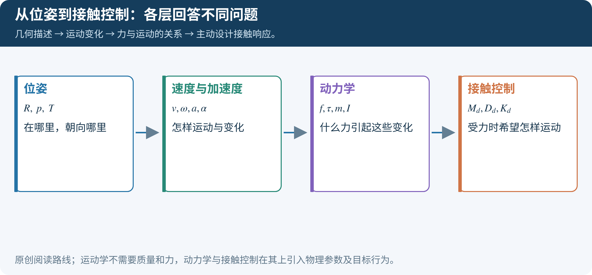
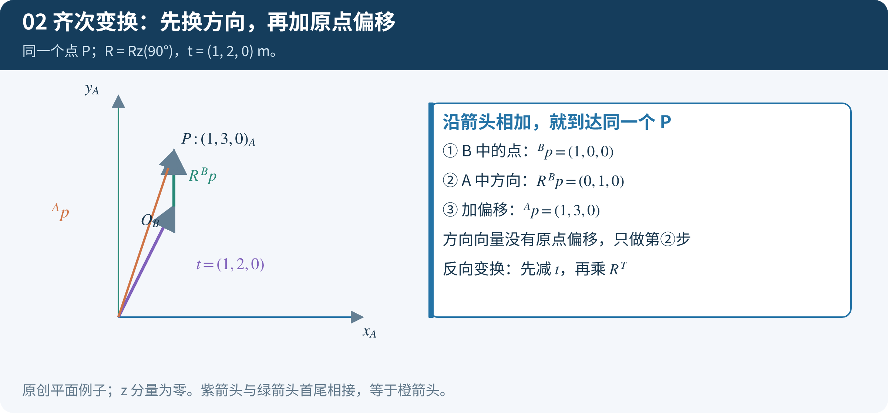
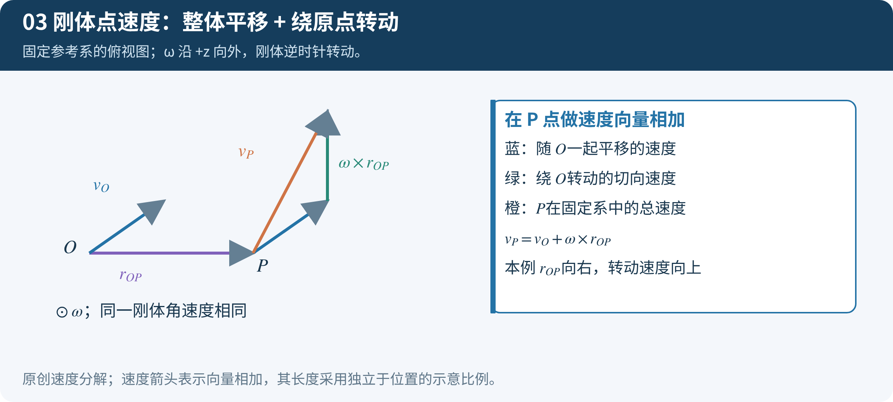
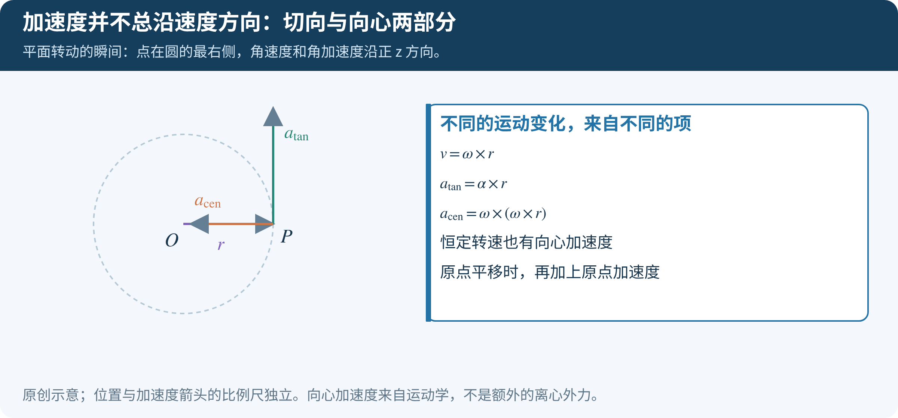
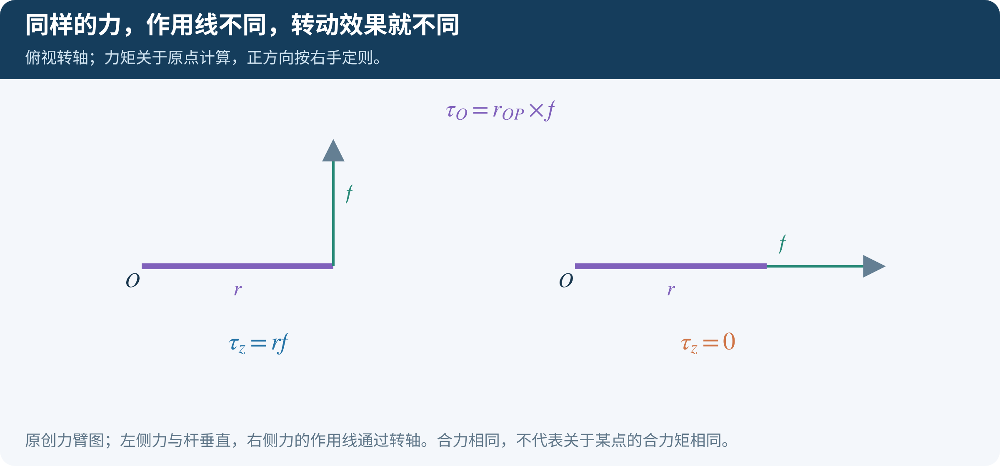

# 刚体运动学基础

机械臂从“抓手在哪里”到“怎样运动”，再到“需要多少力矩、接触时怎样让开”，是一条连续的知识主线，但每一步回答的问题不同。**位置、朝向、速度和加速度属于运动学；引入质量、惯量、力与力矩后进入动力学；阻抗与导纳则进一步设计交互行为。** 本文负责组织这条主线，各主题的直觉、公式与例子在对应概念文中展开。

*原创关系图。箭头表示知识依赖，不表示每个系统必须顺序执行这四个算法。*

## 1. 位姿：先明确描述的是谁、相对于谁

一个刚体在三维空间有三个平移自由度与三个旋转自由度。给它固连一个坐标系，便可以用平移 $p$ 与旋转 $R$ 描述它相对参考系的位姿，并组合成齐次变换 $T\in\mathrm{SE}(3)$。

机械臂上每个连杆都可定义坐标系，串联相邻变换得到末端位姿。旋转矩阵、欧拉角、轴角和四元数是朝向表示，不是四种不同物理姿态；各自的冗余、奇异性与插值性质不同。

*原创坐标例子：先将 B 中的点坐标旋转到 A 的轴方向，再加 B 原点在 A 中的偏移。箭头相加描述同一个点，而非点真的移动了两次。*

详细阅读：[刚体位姿与坐标变换](../../00-concepts/02-classical-robotics/rigid-body-pose.md)。该文保留并整理了原文章的旋转、齐次变换与四元数内容。

## 2. 速度：整块刚体并不是每个点都一样快

一根连杆既可以整体平移，也可以绕参考点转动。各点共享同一个角速度，但其相对转轴的位置不同，线速度不同。不能把位置向量、欧拉角或旋转矩阵简单混在一起求导；首先要说明坐标系与参考点。

*原创分解图。总速度来自参考点速度与相对转动速度之和；位置和速度箭头的尺度不同。*

关节速度经雅可比映射到末端速度。这里还要区分末端点的线速度与特定约定下 twist 的线分量，不能因为都是三维向量就直接替换。

## 3. 加速度：恒速转动为什么仍需要合力

匀速圆周运动的速率不变，但速度方向变化，因此向心加速度不为零。转速增减产生切向加速度，参考点自身平移又贡献另一部分。末端加速度也不只是雅可比乘关节加速度，还包括雅可比随时间变化的贡献。

*原创示意。理解加速度应观察速度向量是否变化，而不仅看速度大小是否变化。*

速度和加速度详细推导、数值检查及滑动点的科里奥利项见 [刚体速度与加速度](../../00-concepts/02-classical-robotics/rigid-body-velocity-acceleration.md)。

## 4. 力与力矩：这是动力学的入口

运动学描述运动，不要求知道质量。同样的轨迹，换上更重的工具后驱动力可能显著改变；同样的力换一个作用点，关于关节的力矩也会改变。动力学因此增加质量、转动惯量、重力与接触力等信息。

*原创力臂图；力矩与参考点和作用线有关。*

应先理解质心合力、关于质心的角动量与惯量，再进入多连杆质量矩阵和递归动力学。详细阅读：[刚体的力、力矩与动力学](../../00-concepts/02-classical-robotics/rigid-body-dynamics.md)。

## 5. 接触控制：不是永远把位置追得越紧越好

自由空间搬运时，位置跟踪常是主要目标；插接、打磨、拖动示教时，环境约束与人施加的力也会影响合理运动。末端需要表现得像具有某种质量、弹簧和阻尼的系统。

阻抗与导纳控制围绕同一交互目标，采用不同常见信号实现路径。详细阅读：[阻抗控制与导纳控制](../../00-concepts/02-classical-robotics/impedance-admittance-control.md)。

## 6. 每个问题应该去哪里找

| 问题 | 直接阅读 |
|---|---|
| 两个坐标系里的位置怎样换算，矩阵怎样连乘？ | [位姿与坐标变换](../../00-concepts/02-classical-robotics/rigid-body-pose.md) |
| 角速度怎样变成某一点的线速度？ | [速度与加速度](../../00-concepts/02-classical-robotics/rigid-body-velocity-acceleration.md) |
| 为什么转速恒定，加速度仍非零？ | [速度与加速度](../../00-concepts/02-classical-robotics/rigid-body-velocity-acceleration.md) |
| 工具重了，为什么需要不同力矩？ | [力、力矩与动力学](../../00-concepts/02-classical-robotics/rigid-body-dynamics.md) |
| 人推机械臂时，它应怎样让开？ | [阻抗与导纳控制](../../00-concepts/02-classical-robotics/impedance-admittance-control.md) |
| 怎样利用速度关系求机器人动作？ | [FRAX 与微分 IK](../../00-concepts/02-classical-robotics/frax-differential-ik.md) |

各概念文均从具体例子开始，可以直接阅读，不要求先记住本文所有术语。本文保留“运动学基础”名称，动力学与接触控制部分只作边界说明与阅读衔接。

## 原始教材与维护

- Modern Robotics：[刚体运动学与角速度](https://modernrobotics.northwestern.edu/nu-gm-book-resource/3-2-2-angular-velocities/)、[力系](https://modernrobotics.northwestern.edu/nu-gm-book-resource/3-4-wrenches/)、[单刚体动力学](https://modernrobotics.northwestern.edu/nu-gm-book-resource/8-2-dynamics-of-a-single-rigid-body-part-1-of-2/)。
- [本次拆分、来源与符号核验](../../../raw/entries/2026-11-20-rigid-mechanics-control.md)。
