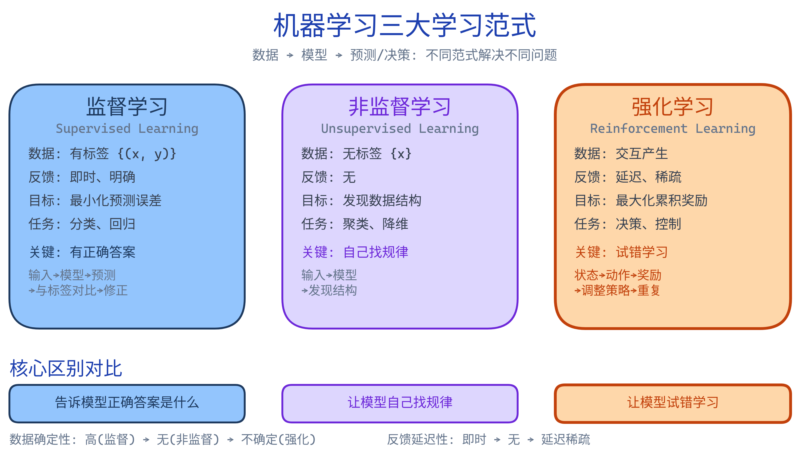
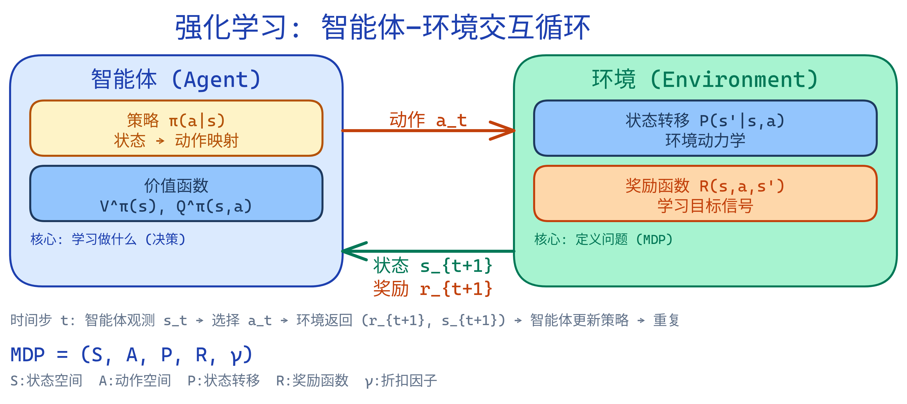
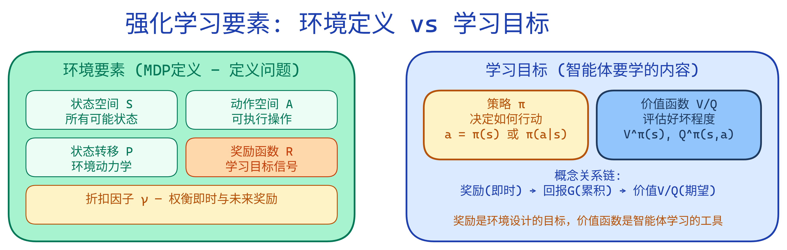
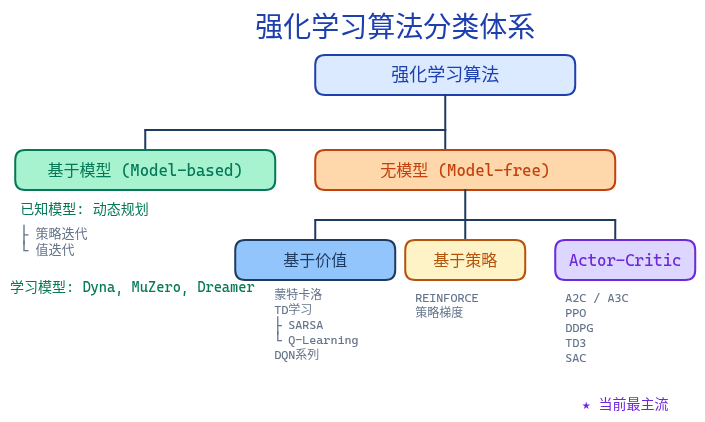
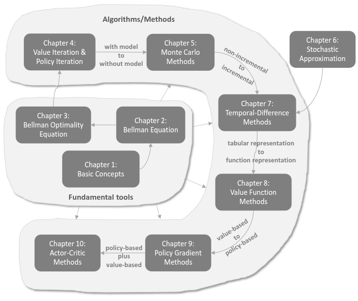
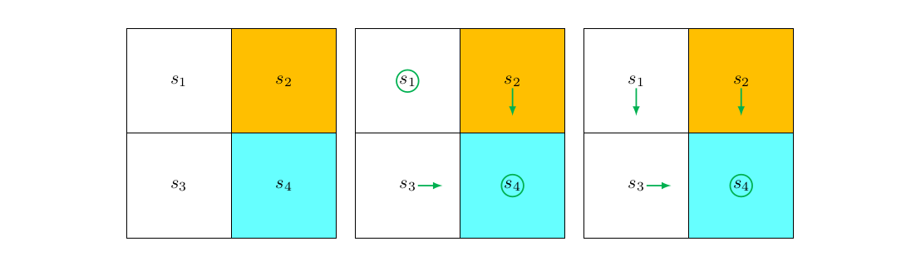
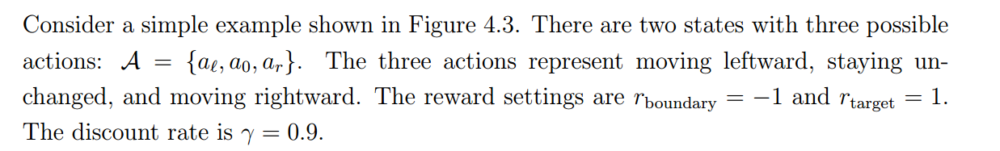

# 强化学习基础

---

## 1. 强化学习技术概述

### 1.1. 机器学习三大范式

**机器学习**是让计算机从数据中自动学习规律和模式的技术。根据学习方式的不同，主要分为三大类：

*机器学习三大学习范式对比：监督学习、非监督学习、强化学习*

#### 1.1.1. 监督学习 (Supervised Learning)

**定义**：从带有标签的数据中学习输入到输出的映射关系。

**数据形式**：训练数据为 $\{(x_1, y_1), (x_2, y_2), ..., (x_n, y_n)\}$，其中 $x$ 是输入特征，$y$ 是标签（正确答案）。

**学习目标**：学习一个函数 $f: X \rightarrow Y$，使得 $f(x) \approx y$。

**典型任务**：

| 任务类型 | 描述 | 示例 |
|----------|------|------|
| 分类 | 预测离散标签 | 图像分类、垃圾邮件检测 |
| 回归 | 预测连续值 | 房价预测、温度预测 |

**特点**：有明确的"正确答案"作为监督信号，学习过程有明确的目标（最小化预测误差），应用最广泛、最成熟。

训练过程：预测 → 计算损失 → 反向传播 → 更新参数 → 重复

#### 1.1.2. 非监督学习 (Unsupervised Learning)

**定义**：从无标签数据中发现隐藏的结构和模式。

**数据形式**：训练数据为 $\{x_1, x_2, ..., x_n\}$，只有输入特征，没有标签。

**典型任务**：

| 任务类型 | 描述 | 示例 |
|----------|------|------|
| 聚类 | 将相似数据分组 | 客户细分、新闻聚类 |
| 降维 | 压缩数据维度 | PCA、t-SNE |
| 密度估计 | 估计数据分布 | 生成模型 |
| 异常检测 | 发现异常样本 | 欺诈检测 |

**特点**：没有标签，没有"正确答案"，学习目标是发现数据内在结构。

#### 1.1.3. 三种范式对比

| 维度 | 监督学习 | 非监督学习 | 强化学习 |
|------|----------|------------|----------|
| **数据** | 有标签数据 | 无标签数据 | 交互产生的数据 |
| **反馈信号** | 即时、明确 | 无 | 延迟、稀疏 |
| **学习目标** | 最小化预测误差 | 发现数据结构 | 最大化累积奖励 |
| **典型任务** | 分类、回归 | 聚类、降维 | 决策、控制 |
| **应用示例** | 图像识别、翻译 | 推荐系统、生成 | 游戏AI、机器人 |

**关键区别**：
- **监督学习**：告诉模型"正确答案是什么" → 输入 → 模型 → 预测 → 与标签对比 → 修正
- **非监督学习**：让模型"自己找规律" → 输入 → 模型 → 发现结构
- **强化学习**：让模型"试错学习" → 状态 → 动作 → 奖励 → 调整策略 → 重复

#### 1.1.4. 其他学习范式

**半监督学习**：少量有标签数据 + 大量无标签数据

**自监督学习**：从数据本身构造监督信号（如 BERT 的掩码语言模型）

**迁移学习**：将源领域的知识迁移到目标领域（如预训练模型微调）

**模仿学习**：从专家示范中学习，介于监督学习和强化学习之间

### 1.2. 强化学习的本质

**核心思想**：智能体通过与环境交互，从反馈中学习如何做出一系列决策以最大化**累积奖励**。

**与监督学习的本质区别**：

| 维度 | 监督学习 | 强化学习 |
|------|----------|----------|
| 数据来源 | 预先收集 | 交互产生 |
| 反馈时机 | 即时 | 延迟 |
| 反馈内容 | 正确答案 | 奖励信号 |
| 决策性质 | 单步预测 | 序列决策 |
| 数据关系 | 独立同分布 | 时序相关 |

**例子对比**：
- **监督学习 - 图像分类**：输入图片，输出类别，立即告诉你对错
- **强化学习 - 下围棋**：输入棋盘状态，输出落子位置，下完整盘棋才知道输赢

### 1.3. 智能体与环境交互

*智能体与环境交互循环：策略输出动作，环境返回状态和奖励，形成闭环*

**时间步 $t$ 的交互流程**：
1. 智能体观测状态 $s_t$
2. 智能体选择动作 $a_t$
3. 环境执行动作，返回奖励 $R_{t+1}$ 和新状态 $s_{t+1}$
4. 智能体根据反馈更新策略

### 1.4. 强化学习的要素

强化学习的要素可以分为两类：**环境要素**（定义问题）和**学习目标**（智能体要学的内容）。

*强化学习要素分类：环境要素定义MDP问题，学习目标是智能体需要掌握的内容*

#### 1.4.1. 环境要素

强化学习的环境由以下五个要素定义。

##### 状态空间 $S$
所有可能状态的集合，是对当前环境情况的完整描述。

- **完全可观测**：智能体能看到完整状态（如棋盘局面）
- **部分可观测**：智能体只能看到部分信息（如扑克只看到手牌）

> 示例：游戏（画面像素、分数）、机器人（关节角度、速度、位置）、棋类（棋盘局面）

##### 动作空间 $A$
智能体可执行动作的集合，分两类：

| 类型 | 描述 | 示例 |
|------|------|------|
| 离散动作 | 有限个选择 | 按键（上下左右） |
| 连续动作 | 连续值 | 力矩、角度、速度 |

##### 状态转移概率 $P$
在状态 $s$ 执行动作 $a$ 后转移到 $s'$ 的概率：

$$P(s'|s,a) = P(S_{t+1}=s' | S_t=s, A_t=a)\tag{1}$$

不同场景下 $P$ 的"来源"不同：

| 场景             | 状态转移 $P$ 是什么           |
| -------------- | ---------------------- |
| 仿真环境           | 物理引擎（MuJoCo、Isaac Gym） |
| 真实世界           | 物理规律本身                 |
| Model-based RL | 智能体学习的"世界模型"           |

##### 奖励函数 $R$
环境对每一步给出的即时反馈，记为 $R(s,a,s')$ 或单步奖励 $R_t$。

奖励设计至关重要：
- **好设计**：胜利 +100、失败 -100、每步 -0.01（鼓励尽快结束）
- **坏设计**：胜利 +100（智能体可能故意拖着不结束游戏）

##### 折扣因子 $\gamma$
平衡眼前与长远收益的权重系数，$0\le\gamma<1$。

- $\gamma \to 0$：短视，只关心眼前奖励
- $\gamma \to 1$：远视，重视长远回报

###### 折扣的数学机制（指数衰减）
第 $k$ 步之后的奖励权重为 $\gamma^k$。因 $0\le\gamma<1$，$\gamma^k$ 随 $k$ 指数衰减——越近权重越大、越远越小（$\gamma=0.9$ 时，5 步后权重 $\approx0.59$，10 步后 $\approx0.35$）。

这解释了：
- 为何 $\gamma\approx0$ 短视、$\gamma\approx1$ 远视；
- 为何需要折扣：① 保证回报有界（$\sum\gamma^k=\frac{1}{1-\gamma}$ 在 $\gamma<1$ 收敛，否则无限长任务里回报发散）；② 未来不确定性更大；③ 符合时间偏好（眼前收益更值钱）。

> **注意**：折扣衰减的是*未来奖励在回报里的权重*，而非"当前动作对未来没影响"——动作仍影响所有后续奖励，只是被折扣得越来越小，故回报与状态价值主要由近期奖励主导。
>
> **边界情况**：episodic（有限步必终止）任务中 $\gamma=1$ 也不会发散，折扣主要是为了强调近期、加速学习；只有 continuing（无限 horizon）任务里 $\gamma<1$ 才是"回报有界"的硬需求。

#### 1.4.2. 学习目标

##### 策略 $\pi$
智能体的行为方式。

- **确定性策略**：$a = \pi(s)$
- **随机策略**：$\pi(a|s) = P(A=a | S=s)$， 有多种概率的选择。
- **神经网络表示**：输入状态 $s$，输出动作概率分布 $\pi(a|s; \theta)$

##### 回报 $G_t$
从时刻 $t$ 起、所有**未来**奖励的折扣累加：

$$G_t = \sum_{k=0}^{\infty} \gamma^k R_{t+k+1}\tag{2}$$

回报可以递归地拆成"下一步的奖励 + 折扣后的未来回报"：

$$
\begin{aligned}
G_t &= R_{t+1} + \gamma R_{t+2} + \gamma^2 R_{t+3} + \dots \\
    &= R_{t+1} + \gamma (R_{t+2} + \gamma R_{t+3} + \dots) \\
    &= R_{t+1} + \gamma G_{t+1}
\end{aligned}
\tag{3}
$$

这个式子说明：$t$ 时刻的回报 = 立刻能拿到的奖励 $R_{t+1}$，加上从下一步起继续累加的回报 $G_{t+1}$ 再打一个折扣 $\gamma$。**这是下面的贝尔曼方程的基础**。

**奖励 和 回报**两者容易理解不清楚，他们是"项"与"和"的关系：

- **奖励 $R_t$（reward）**：单步、即时，由环境在每一步给出——"这一刻拿到多少分"（求和中每个加数 $R_{t+k+1}$ 都是一次奖励）。
- **回报 $G_t$（return）**：从 $t$ 起所有未来奖励的折扣累加——"从这一刻往后总共能拿多少分"（即求和式本身）。

> 一句话：**奖励是"项"，回报是"和"**。奖励由环境/任务定义（目标本身），回报是智能体要最大化、并由价值函数去估计的对象。

##### 价值函数 $V/Q$
**对回报$G_t$取期望**，用于评估状态或动作的好坏， 有状态价值函数和动作价值函数，他们都是对回报$G_t$取期望得到，区别在条件有哪些：

$$V^\pi(s) = \mathbb{E}_\pi[G_t | S_t = s]\tag{4}$$

$$Q^\pi(s,a) = \mathbb{E}_\pi[G_t | S_t = s, A_t = a]\tag{5}$$

也就是说，状态价值函数 $V^\pi(s)$ 是在状态 $s$ 继续按策略 $\pi$ 走下去的期望回报；动作价值函数 $Q^\pi(s,a)$ 是在状态 $s$ 先强制采取动作 $a$、之后再按策略 $\pi$ 走的期望回报。两者都是对回报 $G_t$ 取期望，区别只在于条件中是否固定 $A_t=a$。

利用上面的递归式 $G_t = R_{t+1} + \gamma G_{t+1}$，可以把状态价值也拆成递归形式：

$$V^\pi(s) = \mathbb{E}_\pi[R_{t+1} + \gamma G_{t+1} \mid S_t = s]\tag{6}$$

由期望的线性性，这等于：

$$V^\pi(s) = \mathbb{E}_\pi[R_{t+1} \mid S_t = s] + \gamma \mathbb{E}_\pi[G_{t+1} \mid S_t = s]\tag{7}$$

- **$V(s)$**：回答"*这个状态有多好？*"——评估状态
- **$Q(s,a)$**：回答"*在这个状态下采取这个动作有多好？*"——评估动作

两者关系：

$$V^\pi(s) = \sum_a \pi(a|s) \cdot Q^\pi(s,a)\tag{8}$$

##### 概念关系链
奖励（即时）→ 回报（累积）→ 价值函数（期望）

### 1.5. 算法分类概览

> **Model-Based vs Model-Free**：前面第 3 节动态规划假设已知 $P(s'|s,a)$ 和 $R(s,a)$——智能体"知道世界怎么运转"，可以直接推演规划，这叫 **model-based**。从本节开始，智能体不再拥有环境模型，只能通过试错交互来学习策略或价值函数，这叫 **model-free**。
>
> 打个比方：model-based 像下棋时脑中有一个棋盘模拟器，走一步前先推演几步再决定；model-free 像学骑车，不关心力学原理，直接练"快倒了就往反方向转"，摔多了就会了。
>
> 注意：两者都可以用神经网络来表示——区别不在于"用不用函数"，而在于网络学的是什么：model-based 的 network 输出**下一状态（也就是状态转移）和奖励的预测**，model-free 的 network 输出**动作概率或 Q 值**。

*强化学习算法分类体系：基于模型 vs 无模型，无模型下基于价值/策略/Actor-Critic三大类。后续章节将按此体系展开*

RL的理论学习主要有下面的联系和分类，根据这个层层深入吧。

## 2. 马尔可夫决策过程

### 2.1. 随机过程与马尔可夫性质

先区分两个概念：

> 概率论研究静态随机现象的统计规律。
> 随机过程研究动态随机现象的统计规律。

因此，随机过程是一个或多个事件、随机系统或随机现象**随着时间演变的过程**，其特点是**当前时刻的状态会对下一时刻的状态产生影响**。

**马尔可夫性质**：下一状态只依赖当前状态和动作，与历史无关。

$$P(s_{t+1}|s_t, a_t, s_{t-1}, a_{t-1}, ...) = P(s_{t+1}|s_t, a_t)\tag{9}$$

这意味着："给定当前状态，未来与过去无关"——当前状态包含了所有相关信息。

### 2.2. MDP的形式化定义

强化学习可以形式化为一个马尔可夫决策过程（MDP）：

$$\text{MDP} = (S, A, P, R, \gamma)\tag{10}$$

其中：
- **S**：状态空间（所有可能状态的集合）
- **A**：动作空间（智能体可以执行的所有操作）
- **P**：状态转移概率 $P(s'|s,a)$
- **R**：奖励函数 $R(s,a,s')$
- **$\gamma$**：折扣因子（权衡即时与未来奖励）

### 2.3. 部分可观测 MDP (POMDP)

MDP 假设智能体在每个时刻都能**完整观测**当前状态 $s_t$（如棋盘上所有棋子的位置）。但在许多真实场景中，这个假设并不成立：

- **扑克牌**：只能看到自己的手牌和公共牌，看不到对手的牌
- **机器人导航**：传感器只能感知周围一定范围，看不到墙后的环境
- **对话系统**：无法直接观测用户的真实意图，只能通过文字推断

这类问题称为**部分可观测马尔可夫决策过程（POMDP）**，在 MDP 五元组基础上增加两个要素：

$$\text{POMDP} = (S, A, P, R, \Omega, O, \gamma)\tag{11}$$

| 符号 | 含义 | 示例 |
|------|------|------|
| $\Omega$ | 观测空间 | 扑克中可见的牌面组合 |
| $O(o \mid s', a)$ | 观测概率：执行 $a$ 后到达 $s'$ 时观测到 $o$ 的概率 | 传感器噪声模型 |

由于无法直接获取真实状态，智能体需要维护一个**信念状态（belief state）** $b(s)$——在所有可能状态上的概率分布，并随着新观测不断更新。这使得 POMDP 的求解比 MDP 困难得多（信念空间是连续的，即使状态空间离散）。

> 实际中，大多数 RL 问题都是 POMDP，但算法通常当 MDP 近似处理——用观测历史（如堆叠最近几帧画面）或 RNN 来隐式编码信念状态。

---

## 3. 动态规划

**适用条件**：已知环境模型（状态转移概率 $P$ 和奖励函数 $R$）

动态规划是强化学习的理论基石，虽然在实际中很少直接使用（因为需要完整的环境模型），但理解动态规划对于理解后续所有算法至关重要。

### 3.1. 贝尔曼方程

**核心思想**：当前价值 = 即时奖励 + 下一状态的折扣价值。*这是强化学习最重要的数学基础。*

> **记号约定**：本节严格采用赵世钰《强化学习的数学基础》第 2 章的记号——状态价值记 $v_\pi(s)$、动作价值记 $q_\pi(s,a)$（小写，下标带策略 $\pi$）；系统模型概率用小写 $p(r|s,a)$、$p(s'|s,a)$，分别表示在 $s$ 做 $a$ 后**即时奖励 $r$ 的分布**与**下一状态 $s'$ 的分布**。它们与文中其他处的 $V^\pi(s)/Q^\pi(s,a)$ 及 $P(s'|s,a)/R(s,a,s')$ 等价（后者是"奖励/转移依赖 $(s,a,s')$"的写法，见下方等价形式）。下面推导按赵世钰《强化学习的数学基础》§2.4（贝尔曼方程）与 §2.8（动作价值）逐步展开，公式采用文章自身连续编号。

**贝尔曼期望方程（最终形式，先给结论，下面逐步推导）**：

$$
\begin{aligned}
v_\pi(s) &= \sum_{a\in\mathcal{A}} \pi(a|s)\Bigg[ \sum_{r\in\mathcal{R}} p(r|s,a)\,r \\
         &\qquad + \gamma \sum_{s'\in\mathcal{S}} p(s'|s,a)\,v_\pi(s') \Bigg], \quad \forall s\in\mathcal{S}
\end{aligned}
\tag{12}
$$

$$
\begin{aligned}
q_\pi(s,a) &= \sum_{r\in\mathcal{R}} p(r|s,a)\,r \\
           &\quad + \gamma \sum_{s'\in\mathcal{S}} p(s'|s,a)\,v_\pi(s')
\end{aligned}
\tag{13}
$$

#### 3.1.1. 状态价值 $v_\pi(s)$ 的推导

从状态价值的定义出发，它是"从状态 $s$ 出发按策略 $\pi$ 走下去的期望回报"：

$$v_\pi(s) \doteq \mathbb{E}[G_t \mid S_t = s]\tag{14}$$

**第一步**：把回报的递归式 $G_t = R_{t+1} + \gamma G_{t+1}$ 代入定义，由期望的线性性将[式(14)](#eq:value-split)拆成"即时奖励的期望"与"未来回报的期望"两项:

$$
\begin{aligned}
v_\pi(s) &= \mathbb{E}[R_{t+1} + \gamma G_{t+1} \mid S_t = s] \\
         &= \underbrace{\mathbb{E}[R_{t+1} \mid S_t = s]}_{\text{即时奖励的期望}} \;+\; \gamma \underbrace{\mathbb{E}[G_{t+1} \mid S_t = s]}_{\text{未来回报的期望}}
\end{aligned}
\tag{15}
$$

下面分别计算这两项——这是推导的关键。

**第二步·第一项** $\mathbb{E}[R_{t+1} \mid S_t = s]$：用**全期望公式**（law of total expectation），先对"在 $s$ 选了哪个动作 $a$"展开，再对奖励 $r$ 展开：

$$
\begin{aligned}
\mathbb{E}[R_{t+1} \mid S_t = s] &= \sum_{a\in\mathcal{A}} \pi(a|s)\,\mathbb{E}[R_{t+1}\mid S_t=s, A_t=a] \\
                                 &= \sum_{a\in\mathcal{A}} \pi(a|s) \sum_{r\in\mathcal{R}} p(r|s,a)\,r
\end{aligned}
\tag{16}
$$

**第三步·第二项** $\mathbb{E}[G_{t+1} \mid S_t = s]$：先按"下一状态 $s'$"展开，再用**马尔可夫性质**——未来回报 $G_{t+1}$ 只依赖当前状态 $S_{t+1}=s'$，与更早的 $S_t=s$ 无关，故 $\mathbb{E}[G_{t+1}\mid S_t=s, S_{t+1}=s'] = \mathbb{E}[G_{t+1}\mid S_{t+1}=s'] = v_\pi(s')$；最后把 $p(s'|s)$ 用全概率写成 $\sum_a \pi(a|s)p(s'|s,a)$：

$$
\begin{aligned}
\mathbb{E}[G_{t+1} \mid S_t = s] &= \sum_{s'\in\mathcal{S}} \mathbb{E}[G_{t+1}\mid S_t=s, S_{t+1}=s']\,p(s'|s) \\
                                 &= \sum_{s'\in\mathcal{S}} v_\pi(s')\,p(s'|s) \\
                                 &= \sum_{s'\in\mathcal{S}} v_\pi(s') \sum_{a\in\mathcal{A}} p(s'|s,a)\,\pi(a|s)
\end{aligned}
\tag{17}
$$

**第四步**：把[式(16)](#eq:imm-reward)、[式(17)](#eq:future-reward) 代回 [式(15)](#eq:value-split)，整理成"对动作 $a$ 统一加权"的形式，即得**贝尔曼方程**（[式(12)](#eq:bellman)，见上方结论）：

$$
\begin{aligned}
v_\pi(s) &= \sum_{a\in\mathcal{A}} \pi(a|s)\Bigg[ \sum_{r\in\mathcal{R}} p(r|s,a)\,r + \gamma \sum_{s'\in\mathcal{S}} p(s'|s,a)\,v_\pi(s') \Bigg], \quad \forall s\in\mathcal{S}
\end{aligned}
\tag{18}
$$

> **直觉**：方括号里两项分别是"做动作 $a$ 后**即时奖励**的均值"与"做动作 $a$ 后到达下一状态、其**状态价值**的折扣均值"；方括号外再对策略 $\pi$ 选哪个动作加权平均。所以 $v_\pi(s)$ = 对所有"动作 × 下一状态"加权平均（即时奖励 + 折扣后的下一状态价值）。

> **等价形式**：若奖励只取决于下一状态 $s'$（记 $r(s')$），则 $p(r(s')|s,a)=p(s'|s,a)$，[式(12)](#eq:bellman) 可合并成更紧凑的 $\displaystyle v_\pi(s)=\sum_a\pi(a|s)\sum_{s'}p(s'|s,a)\big[r(s')+\gamma v_\pi(s')\big]$，也常写作 $\sum_a\pi(a|s)\sum_{s'}P(s'|s,a)[R(s,a,s')+\gamma V^\pi(s')]$——这就是文中其他处用的形式。

#### 3.1.2. 贝尔曼方程的矩阵-向量形式与求解
##### 贝尔曼方程的矩阵-向量形式

**统一记号**：把即时奖励的期望记为 $R^\pi(s)=\mathbb{E}[R_{t+1}|S_t=s]$，把"在策略 $\pi$ 下从 $s$ 转移到 $s'$ 的总概率"记为 $p^\pi(s'|s)=\sum_a\pi(a|s)P(s'|s,a)$。则贝尔曼期望方程可重写为

$$V^\pi(s)=R^\pi(s)+\gamma\sum_{s'}p^\pi(s'|s)V^\pi(s').\tag{19}$$

把所有状态按 $s_1,\dots,s_n$（$n=|S|$）编号，堆叠成向量 $v^\pi=[V^\pi(s_1),\dots,V^\pi(s_n)]^\top$，得到

$$\boxed{v^\pi = R^\pi + \gamma P^\pi v^\pi}\tag{20}$$

展开为逐状态的形式：
$$
\underbrace{\begin{bmatrix} v_\pi(s_1) \\ v_\pi(s_2) \\ v_\pi(s_3) \\ v_\pi(s_4) \end{bmatrix}}_{\mathbf{v}_\pi (4\times 1)}
=
\underbrace{\begin{bmatrix} r_\pi(s_1) \\ r_\pi(s_2) \\ r_\pi(s_3) \\ r_\pi(s_4) \end{bmatrix}}_{\mathbf{r}_\pi (4\times 1)}
+ \gamma
\underbrace{\begin{bmatrix} 
P_\pi(s_1|s_1) & P_\pi(s_2|s_1) & P_\pi(s_3|s_1) & P_\pi(s_4|s_1) \\
P_\pi(s_1|s_2) & P_\pi(s_2|s_2) & P_\pi(s_3|s_2) & P_\pi(s_4|s_2) \\
P_\pi(s_1|s_3) & P_\pi(s_2|s_3) & P_\pi(s_3|s_3) & P_\pi(s_4|s_3) \\
P_\pi(s_1|s_4) & P_\pi(s_2|s_4) & P_\pi(s_3|s_4) & P_\pi(s_4|s_4)
\end{bmatrix}}_{\mathbf{P}_\pi (4\times 4)}
\underbrace{\begin{bmatrix} v_\pi(s_1) \\ v_\pi(s_2) \\ v_\pi(s_3) \\ v_\pi(s_4) \end{bmatrix}}_{\mathbf{v}_\pi (4\times 1)}
\tag{21}
$$

其中 $P^\pi$ 是 $n\times n$ 状态转移矩阵。**怎么理解这个式子**：等号右边第一项是"立刻能拿到的平均奖励"，第二项是"下一步平均状态值再打个折扣"——这正是"当前价值 = 即时奖励 + 折扣的未来价值"的矩阵版本。
给出一个例子：

如上图所示，奖励 $R_{\text{target}}=1$、$R_{\text{forbidden}}=-1$，$s_1\to s_3\to s_4$（奖励 0,1），$s_2\to s_4$（奖励1），$s_4\to s_4$（奖励1）。贝尔曼方程为

$$V(s_1)=0+\gamma V(s_3),\quad V(s_2)=1+\gamma V(s_4),\quad V(s_3)=1+\gamma V(s_4),\quad V(s_4)=1+\gamma V(s_4).\tag{22}$$

解得 $V(s_4)=\frac{1}{1-\gamma}$，$V(s_3)=V(s_2)=\frac{1}{1-\gamma}$，$V(s_1)=\frac{\gamma}{1-\gamma}$。取 $\gamma=0.9$ 得

$$V(s_1)=9,\quad V(s_2)=V(s_3)=V(s_4)=10.\tag{23}$$

**这个例子的意义**：状态值能用于评估策略。若换一个会在 $s_1$ 误入禁区（奖励 $-1$、概率 0.5 向下、0.5 向右）的随机策略，则 $V(s_1)=0.5[0+\gamma V(s_3)]+0.5[-1+\gamma V(s_2)]=-0.5+\frac{\gamma}{1-\gamma}=8.5<9$，数学上验证了"避开禁区"的策略更优。注意：**不同策略可以拥有完全相同的状态值**（如两条"好"策略在第四列顶部两个状态动作不同，但 $V$ 相同）。

**贝尔曼最优方程（BOE）**：

$$V^*(s) = \max_a \sum_{s'} P(s'|s,a) [R(s,a,s') + \gamma V^*(s')]\tag{24}$$
$$Q^*(s,a) = \sum_{s'} P(s'|s,a) [R(s,a,s') + \gamma \max_{a'} Q^*(s',a')]\tag{25}$$

**最优策略**：$\pi^*(a|s) = \arg\max_a Q^*(s,a)$
##### 两种求解方式

###### **闭式解**：
这是一个线性方程组，直接解为

$$v^\pi=(I-\gamma P^\pi)^{-1}R^\pi.\tag{26}$$

**为什么 $(I-\gamma P^\pi)$ 一定可逆（直觉）**：因为 $\gamma<1$，每一步都打了折扣，远处状态的影响会被无限衰减，所以"无限未来的累加"最终收敛、不会发散到无穷或塌成奇异。严格地说它等价于级数 $(I-\gamma P^\pi)^{-1}=I+\gamma P^\pi+\gamma^2 P^{\pi2}+\cdots$，每一项都非负，因此这个逆矩阵每个元素 $\ge$ 单位阵——**单调性**：奖励越大，算出的状态值也越大（这一点在理解"为什么贪心改进不会变差"时很关键）。

###### **迭代求解（策略评估）**：
实际算法并不真的求逆，而是反复做

$$v_{k+1}=R^\pi+\gamma P^\pi v_k,\quad k=0,1,2,\dots\tag{27}$$

**为什么它一定会收敛**：每次迭代都把"估计误差"乘以一个 $<1$ 的因子（折扣 + 概率转移都不会放大误差），所以误差像 $\gamma^k$ 一样指数衰减到 0。这就是后面所有 DP / TD 算法"迭代更新"统一的理论依据。

#### 3.1.3. 从状态价值到动作价值

动作价值定义为**状态-动作对 $(s,a)$ 的期望回报**——"在 $s$ 先**强制**做动作 $a$、之后再按 $\pi$ 走"的期望回报：

$$q_\pi(s,a) \doteq \mathbb{E}[G_t \mid S_t = s, A_t = a]\tag{28}$$

赵世钰没有从定义硬推，而是给出 $v_\pi$ 与 $q_\pi$ **互相印证的两条关系**——这是理解动作价值最清晰的角度。

**关系一（状态价值 = 动作价值的期望）**：由条件期望的性质 $\mathbb{E}[G_t\mid S_t=s]=\sum_a \mathbb{E}[G_t\mid S_t=s, A_t=a]\,\pi(a|s)$，左边正是 $v_\pi(s)$、被求和的每一项正是 $q_\pi(s,a)$，故

$$v_\pi(s) = \sum_{a\in\mathcal{A}} \pi(a|s)\,q_\pi(s,a)\tag{29}$$

即：一个状态的价值 = 该状态下各动作价值的策略加权平均。

**关系二（动作价值 = 即时奖励均值 + 折扣未来价值均值）**：贝尔曼方程 [式(12)](#eq:bellman) 可写成

$$v_\pi(s) = \sum_{a\in\mathcal{A}} \pi(a|s)\underbrace{\left[ \sum_{r\in\mathcal{R}} p(r|s,a)\,r + \gamma \sum_{s'\in\mathcal{S}} p(s'|s,a)\,v_\pi(s') \right]}_{\text{方括号整体记为 } \square(s,a)}\tag{30}$$

而 [式(19)](#eq:v-from-q) 给出 $v_\pi(s) = \sum_{a\in\mathcal{A}} \pi(a|s)\,q_\pi(s,a)$。两者左端同为 $v_\pi(s)$、外层同为 $\sum_a \pi(a|s)\,(\cdot)$ 的加权和，逐项对比即得 $\square(s,a) = q_\pi(s,a)$，因此

$$
\begin{aligned}
q_\pi(s,a) &= \sum_{r\in\mathcal{R}} p(r|s,a)\,r  + \gamma \sum_{s'\in\mathcal{S}} p(s'|s,a)\,v_\pi(s')
\end{aligned}
\tag{31}
$$

> [式(19)](#eq:v-from-q) 和 [式(13)](#eq:q-from-v) 是同一枚硬币的两面：[式(19)](#eq:v-from-q) 说明**如何从动作价值算状态价值**，[式(13)](#eq:q-from-v) 说明**如何从状态价值算动作价值**。注意 [式(13)](#eq:q-from-v) 与 $v_\pi$ 的推导不同——这里动作 $a$ 在 $t$ 时刻**已经固定**，故**不**再对 $a$ 求和，只对下一状态 $s'$（与奖励 $r$）展开。

**用动作价值表示的贝尔曼方程（[式(22)](#eq:bellman-q)）**：把 [式(19)](#eq:v-from-q) $v_\pi(s')=\sum_{a'}\pi(a'|s')q_\pi(s',a')$ 代入 [式(13)](#eq:q-from-v) 右端第二项，得关于动作价值的自洽方程：

$$
\begin{aligned}
q_\pi(s,a) &= \sum_{r\in\mathcal{R}} p(r|s,a)\,r+\gamma \sum_{s'\in\mathcal{S}} p(s'|s,a) \sum_{a'\in\mathcal{A}(s')} \pi(a'|s')\,q_\pi(s',a')
\end{aligned}
\tag{32}
$$

> **直觉**：在 $s$ 强制做 $a$（不对 $a$ 求和，只对到达的 $s'$ 与下一步动作 $a'$ 展开）→ 即时奖励均值 + 折扣后的"下一步按 $\pi$ 走的动作价值加权平均"。这正是上方 $Q^\pi$ 那条结论 $\sum_{s'}P(s'|s,a)[R(s,a,s')+\gamma\sum_{a'}\pi(a'|s')Q^\pi(s',a')]$ 的来源。

> **赵世钰《强化学习的数学基础》的核心贡献之一**：把逐状态的贝尔曼方程写成**矩阵-向量形式**（见上节）。这样做的好处是——原本"每个状态一个方程、互相耦合"的混乱，被整理成一个干净的线性方程组，于是可解性、收敛性都能一眼看明白。下面从矩阵形式回到逐个状态，讨论动作价值。

#### 3.1.4. 贝尔曼最优方程（BOE）到底在解什么
根据上面的分析，我们知道**状态值与动作值的关系**：

$$
\begin{aligned}
Q^\pi(s,a) &= \sum_r p(r|s,a)r+\gamma\sum_{s'}p(s'|s,a)V^\pi(s'), \\
V^\pi(s)   &= \sum_a\pi(a|s)Q^\pi(s,a).
\end{aligned}
\tag{33}
$$

即 **$Q$ 是"在 $s$ 选 $a$ 后"的价值，$V$ 是所有可选动作 $Q$ 的加权平均**。

把 BOE 写成矩阵-向量形式：记右端为算子 $f(v)=\max_{\pi}(R^\pi+\gamma P^\pi v)$，则

$$v = f(v).\tag{34}$$

这是一个**非线性方程**——解 $v^*$ 就是 $f$ 的**不动点**（"把自己代进去还是自己"）。

**关键直觉（压缩映射）**：$f$ 是一个"压缩映射"——任意两个价值向量 $v_1,v_2$ 经过 $f$ 作用后，它们的差距会被折扣因子 $\gamma$ 进一步缩小：$\|f(v_1)-f(v_2)\|_\infty\le\gamma\|v_1-v_2\|_\infty$。由此立刻得到三个结论：

- **存在且唯一**：BOE 一定有唯一解 $v^*$（最优状态值唯一）。
- **怎么解**：从任意初值 $v_0$ 反复迭代 $v_{k+1}=f(v_k)$（这就是**值迭代**），指数收敛到 $v^*$。
- **最优性**：对任意策略 $\pi$ 都有 $v^*\ge v^\pi$，即 $v^*$ 就是真正的最优状态值。

**一个容易混淆的点**：最优状态值 $v^*$ **唯一**，但达到它的最优策略**不一定唯一**——可能有多个不同的贪心策略给出完全相同的 $v^*$（例如两条动作不同但价值相同的"好"策略）。

接下来我们就要介绍一些求解最优策略的方法了。
### 3.2. 值迭代

回顾 §3.1.4 的贝尔曼最优方程（BOE）：

$$v = f(v) = \max_\pi (r_\pi + \gamma P_\pi v)\tag{35}$$

这是一个不动点方程。求解它的一个自然方法是**不动点迭代**：从一个初始猜测 $v_0$ 出发，反复用 $f$ 作用：

$$v_{k+1} = f(v_k) = \max_\pi (r_\pi + \gamma P_\pi v_k)\tag{36}$$

这正是值迭代算法的核心——用 $f(v_k)$ 计算 $v_{k+1}$。由于 $f$ 是压缩映射，$v_k$ 最终收敛到唯一的最优状态值 $v^*$。

上式可以分解为两步：策略更新和价值更新：

**步骤一：策略更新**——对当前价值 $v_k$，贪心选一个最优策略：

$$\pi_{k+1} = \arg\max_\pi (r_\pi + \gamma P_\pi v_k)\tag{37}$$
其中 $v_k$ 是上一次迭代中得到的。

**步骤二：价值更新**——计算新策略对应的价值：

$$v_{k+1} = r_{\pi_{k+1}} + \gamma P_{\pi_{k+1}} v_k\tag{38}$$

这里的$v_{k+1}$ 将被用在下一步迭代中。

**伪代码**：

$$
\begin{array}{l}
\textbf{算法：值迭代} \\
\textbf{输入：} r(s,a),\; p(s'|s,a),\; p(r|s,a),\; \gamma,\; \varepsilon \\
\textbf{输出：} v^*(s),\; \pi^*(s) \\[4pt]
 1\!:\; \text{初始化 } v(s) \leftarrow 0,\; \forall s \in \mathcal{S} \\
 2\!:\; \textbf{loop} \\
 3\!:\; \quad \textbf{for } s \in \mathcal{S} \textbf{ do} \\
 4\!:\; \quad\quad \textbf{for } a \in \mathcal{A}(s) \textbf{ do} \\
 5\!:\; \quad\quad\quad q(s,a) \leftarrow \sum_r p(r|s,a)r + \gamma \sum_{s'} p(s'|s,a)v(s') \\
 6\!:\; \quad\quad v'(s) \leftarrow \max_a q(s,a) \\
 7\!:\; \quad\quad \pi'(s) \leftarrow \arg\max_a q(s,a) \\
 8\!:\; \quad \textbf{if } \max_s |v'(s) - v(s)| < \varepsilon \textbf{ then} \\
 9\!:\; \quad\quad \textbf{break} \\
10\!:\; \quad v \leftarrow v' \\
11\!:\; \textbf{end loop} \\
12\!:\; \textbf{return } v,\; \pi'
\end{array}
\tag{39}
$$

#### 3.2.1. 手算例题（2×2 网格）

2×2 网格，4 个状态，$\gamma=0.9$。初始 $v_0(s)=0,\;\forall s$。
> 其中 $r=-1$ 对应撞边界或禁行区域、$r=0$ 对应正常转移、$r=1$ 对应到达目标。注意 $s_4$ 向左走到 $s_3$ 是正常转移 $(r=0)$，而 $s_2$ 停留 $(a_5)$ 因处于禁行区域故 $r=-1$。

动作按移动方向编号：$a_1$ 上、$a_2$ 右、$a_3$ 下、$a_4$ 左、$a_5$ 停留。每个状态都有全部 5 个动作可选，其 $q(s,a)=r+\gamma v(s')$ 汇总如下：

| 状态    | $a_1$（上）           | $a_2$（右）           | $a_3$（下）           | $a_4$（左）           | $a_5$（停）           |
| ----- | ------------------ | ------------------ | ------------------ | ------------------ | ------------------ |
| $s_1$ | $-1+\gamma v(s_1)$ | $0+\gamma v(s_2)$  | $0+\gamma v(s_3)$  | $-1+\gamma v(s_1)$ | $0+\gamma v(s_1)$  |
| $s_2$ | $-1+\gamma v(s_2)$ | $-1+\gamma v(s_2)$ | $1+\gamma v(s_4)$  | $0+\gamma v(s_1)$  | $-1+\gamma v(s_2)$ |
| $s_3$ | $0+\gamma v(s_1)$  | $1+\gamma v(s_4)$  | $-1+\gamma v(s_3)$ | $-1+\gamma v(s_3)$ | $0+\gamma v(s_3)$  |
| $s_4$ | $-1+\gamma v(s_4)$ | $-1+\gamma v(s_4)$ | $-1+\gamma v(s_4)$ | $0+\gamma v(s_3)$  | $1+\gamma v(s_4)$  |
*各状态-动作对的 $q(s,a)$ 表达式（赵世钰《强化学习的数学基础》Table 4.1）*

**$k=0$**（$v_0=[0,0,0,0]$）：

| $s$   | $a$   | $r$  | $q(s,a) = r + \gamma v_0(s')$ | $v_1(s)=\max_a q(s,a)$ | $\pi_1(s)=\arg\max_a q(s,a)$ |
| ----- | ----- | ---- | ----------------------------- | ---------------------- | ---------------------------- |
| $s_1$ | $a_1$ | $-1$ | $-1 + 0.9 \cdot 0 = -1$       | $0$                    | $a_2$ / $a_3$ / $a_5$        |
|       | $a_2$ | $0$  | $0 + 0.9 \cdot 0 = 0$         |                        |                              |
|       | $a_3$ | $0$  | $0 + 0.9 \cdot 0 = 0$         |                        |                              |
|       | $a_4$ | $-1$ | $-1 + 0.9 \cdot 0 = -1$       |                        |                              |
|       | $a_5$ | $0$  | $0 + 0.9 \cdot 0 = 0$         |                        |                              |
| $s_2$ | $a_1$ | $-1$ | $-1 + 0.9 \cdot 0 = -1$       | $1$                    | $a_3$                        |
|       | $a_2$ | $-1$ | $-1 + 0.9 \cdot 0 = -1$       |                        |                              |
|       | $a_3$ | $1$  | $1 + 0.9 \cdot 0 = 1$         |                        |                              |
|       | $a_4$ | $0$  | $0 + 0.9 \cdot 0 = 0$         |                        |                              |
|       | $a_5$ | $-1$ | $-1 + 0.9 \cdot 0 = -1$       |                        |                              |
| $s_3$ | $a_1$ | $0$  | $0 + 0.9 \cdot 0 = 0$         | $1$                    | $a_2$                        |
|       | $a_2$ | $1$  | $1 + 0.9 \cdot 0 = 1$         |                        |                              |
|       | $a_3$ | $-1$ | $-1 + 0.9 \cdot 0 = -1$       |                        |                              |
|       | $a_4$ | $-1$ | $-1 + 0.9 \cdot 0 = -1$       |                        |                              |
|       | $a_5$ | $0$  | $0 + 0.9 \cdot 0 = 0$         |                        |                              |
| $s_4$ | $a_1$ | $-1$ | $-1 + 0.9 \cdot 0 = -1$       | $1$                    | $a_5$                        |
|       | $a_2$ | $-1$ | $-1 + 0.9 \cdot 0 = -1$       |                        |                              |
|       | $a_3$ | $-1$ | $-1 + 0.9 \cdot 0 = -1$       |                        |                              |
|       | $a_4$ | $0$  | $0 + 0.9 \cdot 0 = 0$         |                        |                              |
|       | $a_5$ | $1$  | $1 + 0.9 \cdot 0 = 1$         |                        |                              |

$v_1=[0,1,1,1]$

$\max_s |v_1(s)-v_0(s)| = \max\{|0-0|,|1-0|,|1-0|,|1-0|\} = 1$

**$k=1$**（$v_1=[0,1,1,1]$）：

| $s$ | $a$ | $r$ | $q(s,a) = r + \gamma v_1(s')$ | $v_2(s)=\max_a q(s,a)$ | $\pi_2(s)=\arg\max_a q(s,a)$ |
| --- | --- | --- | ----------------------------- | ---------------------- | ---------------------------- |
| $s_1$ | $a_1$ | $-1$ | $-1 + 0.9 \cdot 0 = -1$ | $0.9$ | $a_2$ / $a_3$ |
| | $a_2$ | $0$ | $0 + 0.9 \cdot 1 = 0.9$ | | |
| | $a_3$ | $0$ | $0 + 0.9 \cdot 1 = 0.9$ | | |
| | $a_4$ | $-1$ | $-1 + 0.9 \cdot 0 = -1$ | | |
| | $a_5$ | $0$ | $0 + 0.9 \cdot 0 = 0$ | | |
| $s_2$ | $a_1$ | $-1$ | $-1 + 0.9 \cdot 1 = -0.1$ | $1.9$ | $a_3$ |
| | $a_2$ | $-1$ | $-1 + 0.9 \cdot 1 = -0.1$ | | |
| | $a_3$ | $1$ | $1 + 0.9 \cdot 1 = 1.9$ | | |
| | $a_4$ | $0$ | $0 + 0.9 \cdot 0 = 0$ | | |
| | $a_5$ | $-1$ | $-1 + 0.9 \cdot 1 = -0.1$ | | |
| $s_3$ | $a_1$ | $0$ | $0 + 0.9 \cdot 0 = 0$ | $1.9$ | $a_2$ |
| | $a_2$ | $1$ | $1 + 0.9 \cdot 1 = 1.9$ | | |
| | $a_3$ | $-1$ | $-1 + 0.9 \cdot 1 = -0.1$ | | |
| | $a_4$ | $-1$ | $-1 + 0.9 \cdot 1 = -0.1$ | | |
| | $a_5$ | $0$ | $0 + 0.9 \cdot 1 = 0.9$ | | |
| $s_4$ | $a_1$ | $-1$ | $-1 + 0.9 \cdot 1 = -0.1$ | $1.9$ | $a_5$ |
| | $a_2$ | $-1$ | $-1 + 0.9 \cdot 1 = -0.1$ | | |
| | $a_3$ | $-1$ | $-1 + 0.9 \cdot 1 = -0.1$ | | |
| | $a_4$ | $0$ | $0 + 0.9 \cdot 1 = 0.9$ | | |
| | $a_5$ | $1$ | $1 + 0.9 \cdot 1 = 1.9$ | | |

$v_2=[0.9,1.9,1.9,1.9]$

$\max_s |v_2(s)-v_1(s)| = \max\{|0.9-0|,|1.9-1|,|1.9-1|,|1.9-1|\} = 0.9$

**$k=2$**（$v_2=[0.9,1.9,1.9,1.9]$）：

| $s$ | $a$ | $r$ | $q(s,a) = r + \gamma v_2(s')$ | $v_3(s)=\max_a q(s,a)$ | $\pi_3(s)=\arg\max_a q(s,a)$ |
| --- | --- | --- | ----------------------------- | ---------------------- | ---------------------------- |
| $s_1$ | $a_1$ | $-1$ | $-1 + 0.9 \cdot 0.9 = -0.19$ | $1.71$ | $a_2$ / $a_3$ |
| | $a_2$ | $0$ | $0 + 0.9 \cdot 1.9 = 1.71$ | | |
| | $a_3$ | $0$ | $0 + 0.9 \cdot 1.9 = 1.71$ | | |
| | $a_4$ | $-1$ | $-1 + 0.9 \cdot 0.9 = -0.19$ | | |
| | $a_5$ | $0$ | $0 + 0.9 \cdot 0.9 = 0.81$ | | |
| $s_2$ | $a_1$ | $-1$ | $-1 + 0.9 \cdot 1.9 = 0.71$ | $2.71$ | $a_3$ |
| | $a_2$ | $-1$ | $-1 + 0.9 \cdot 1.9 = 0.71$ | | |
| | $a_3$ | $1$ | $1 + 0.9 \cdot 1.9 = 2.71$ | | |
| | $a_4$ | $0$ | $0 + 0.9 \cdot 0.9 = 0.81$ | | |
| | $a_5$ | $-1$ | $-1 + 0.9 \cdot 1.9 = 0.71$ | | |
| $s_3$ | $a_1$ | $0$ | $0 + 0.9 \cdot 0.9 = 0.81$ | $2.71$ | $a_2$ |
| | $a_2$ | $1$ | $1 + 0.9 \cdot 1.9 = 2.71$ | | |
| | $a_3$ | $-1$ | $-1 + 0.9 \cdot 1.9 = 0.71$ | | |
| | $a_4$ | $-1$ | $-1 + 0.9 \cdot 1.9 = 0.71$ | | |
| | $a_5$ | $0$ | $0 + 0.9 \cdot 1.9 = 1.71$ | | |
| $s_4$ | $a_1$ | $-1$ | $-1 + 0.9 \cdot 1.9 = 0.71$ | $2.71$ | $a_5$ |
| | $a_2$ | $-1$ | $-1 + 0.9 \cdot 1.9 = 0.71$ | | |
| | $a_3$ | $-1$ | $-1 + 0.9 \cdot 1.9 = 0.71$ | | |
| | $a_4$ | $0$ | $0 + 0.9 \cdot 1.9 = 1.71$ | | |
| | $a_5$ | $1$ | $1 + 0.9 \cdot 1.9 = 2.71$ | | |

$v_3=[1.71,2.71,2.71,2.71]$

$\max_s |v_3(s)-v_2(s)| = \max\{|1.71-0.9|,|2.71-1.9|,|2.71-1.9|,|2.71-1.9|\} = 0.81$

**$k=3$**（$v_3=[1.71,2.71,2.71,2.71]$）：

| $s$ | $a$ | $r$ | $q(s,a) = r + \gamma v_3(s')$ | $v_4(s)=\max_a q(s,a)$ | $\pi_4(s)=\arg\max_a q(s,a)$ |
| --- | --- | --- | ----------------------------- | ---------------------- | ---------------------------- |
| $s_1$ | $a_1$ | $-1$ | $-1 + 0.9 \cdot 1.71 = 0.54$ | $2.44$ | $a_2$ / $a_3$ |
| | $a_2$ | $0$ | $0 + 0.9 \cdot 2.71 = 2.44$ | | |
| | $a_3$ | $0$ | $0 + 0.9 \cdot 2.71 = 2.44$ | | |
| | $a_4$ | $-1$ | $-1 + 0.9 \cdot 1.71 = 0.54$ | | |
| | $a_5$ | $0$ | $0 + 0.9 \cdot 1.71 = 1.54$ | | |
| $s_2$ | $a_1$ | $-1$ | $-1 + 0.9 \cdot 2.71 = 1.44$ | $3.44$ | $a_3$ |
| | $a_2$ | $-1$ | $-1 + 0.9 \cdot 2.71 = 1.44$ | | |
| | $a_3$ | $1$ | $1 + 0.9 \cdot 2.71 = 3.44$ | | |
| | $a_4$ | $0$ | $0 + 0.9 \cdot 1.71 = 1.54$ | | |
| | $a_5$ | $-1$ | $-1 + 0.9 \cdot 2.71 = 1.44$ | | |
| $s_3$ | $a_1$ | $0$ | $0 + 0.9 \cdot 1.71 = 1.54$ | $3.44$ | $a_2$ |
| | $a_2$ | $1$ | $1 + 0.9 \cdot 2.71 = 3.44$ | | |
| | $a_3$ | $-1$ | $-1 + 0.9 \cdot 2.71 = 1.44$ | | |
| | $a_4$ | $-1$ | $-1 + 0.9 \cdot 2.71 = 1.44$ | | |
| | $a_5$ | $0$ | $0 + 0.9 \cdot 2.71 = 2.44$ | | |
| $s_4$ | $a_1$ | $-1$ | $-1 + 0.9 \cdot 2.71 = 1.44$ | $3.44$ | $a_5$ |
| | $a_2$ | $-1$ | $-1 + 0.9 \cdot 2.71 = 1.44$ | | |
| | $a_3$ | $-1$ | $-1 + 0.9 \cdot 2.71 = 1.44$ | | |
| | $a_4$ | $0$ | $0 + 0.9 \cdot 2.71 = 2.44$ | | |
| | $a_5$ | $1$ | $1 + 0.9 \cdot 2.71 = 3.44$ | | |

$v_4=[2.44,3.44,3.44,3.44]$

$\max_s |v_4(s)-v_3(s)| = \max\{|2.44-1.71|,|3.44-2.71|,|3.44-2.71|,|3.44-2.71|\} = 0.73$

**要点**：$\pi_2=\pi_3=\pi_4$，策略在 $k=1$ 就已收敛；但 $v_k$ 的数值还在持续增长，最终收敛到 $v^*(s_4)=\frac{1}{1-0.9}=10$。值迭代常常"**策略先收敛、价值后收敛**"。

### 3.3. 策略迭代

策略迭代是另一种重要的动态规划算法。与值迭代不同，**策略迭代并非直接求解贝尔曼最优方程**，而是交替进行策略评估和策略改进，从而逐步逼近最优策略。策略迭代与值迭代有着密切的联系（见 §3.3.2 对比），并且其思想——"先评估当前策略，再贪心改进"——在后续的无模型强化学习算法中被广泛采用。

策略迭代每轮分两步：

**步骤一：策略评估（Policy Evaluation）**——给定策略 $\pi_k$，求解其状态价值 $v_{\pi_k}$。这一步需要解贝尔曼期望方程：

$$v_{\pi_k} = r_{\pi_k} + \gamma P_{\pi_k} v_{\pi_k}\tag{40}$$

这是一个线性方程组，可以用闭式解 $v_{\pi_k} = (I - \gamma P_{\pi_k})^{-1} r_{\pi_k}$ 直接求解，也可以迭代求解 $v \leftarrow r_{\pi_k} + \gamma P_{\pi_k} v$ 到收敛。

**步骤二：策略改进（Policy Improvement）**——对 $v_{\pi_k}$ 贪心选一个新策略：

$$\pi_{k+1} = \arg\max_\pi (r_\pi + \gamma P_\pi v_{\pi_k})\tag{41}$$

逐状态展开即 $\pi_{k+1}(s) = \arg\max_a q_{\pi_k}(s,a)$，其中 $q_{\pi_k}(s,a) = \sum_r p(r|s,a)r + \gamma \sum_{s'} p(s'|s,a) v_{\pi_k}(s')$。

重复以上两步直到 $\pi_{k+1} = \pi_k$（策略不再变化）。

**策略改进定理**：改进后的策略不会比原来差。因为 $\pi_{k+1}$ 在每个状态都选了当前 $v_{\pi_k}$ 下最好的动作，所以 $v_{\pi_{k+1}} \ge v_{\pi_k}$。于是产生一条单调上升的链：

$$v^{\pi_0} \le v^{\pi_1} \le v^{\pi_2} \le \cdots \le v^*\tag{42}$$

因为状态值有上界 $v^*$，这个单调序列必然收敛，极限就是 $v^*$。

**伪代码**：

$$
\begin{array}{l}
\textbf{算法：策略迭代} \\
\textbf{输入：} r(s,a),\; p(s'|s,a),\; p(r|s,a),\; \gamma,\; \varepsilon \\
\textbf{输出：} v^*(s),\; \pi^*(s) \\[4pt]
 1\!:\; \text{初始化 } \pi(s) \leftarrow \text{任意策略},\; \forall s \in \mathcal{S} \\
 2\!:\; \textbf{loop} \\
 3\!:\; \quad \text{// 步骤一：策略评估} \\
 4\!:\; \quad \text{初始化 } v(s) \leftarrow 0,\; \forall s \in \mathcal{S} \\
 5\!:\; \quad \textbf{loop} \\
 6\!:\; \quad\quad \textbf{for } s \in \mathcal{S} \textbf{ do} \\
 7\!:\; \quad\quad\quad v'(s) \leftarrow \sum_r p(r|s,\pi(s))r + \gamma \sum_{s'} p(s'|s,\pi(s))\,v(s') \\
 8\!:\; \quad\quad \textbf{if } \max_s |v'(s) - v(s)| < \varepsilon \textbf{ then break} \\
 9\!:\; \quad\quad v \leftarrow v' \\
10\!:\; \quad \textbf{end loop} \\
11\!:\; \quad \text{// 步骤二：策略改进} \\
12\!:\; \quad \textbf{for } s \in \mathcal{S} \textbf{ do} \\
13\!:\; \quad\quad \textbf{for } a \in \mathcal{A}(s) \textbf{ do} \\
14\!:\; \quad\quad\quad q(s,a) \leftarrow \sum_r p(r|s,a)r + \gamma \sum_{s'} p(s'|s,a)\,v(s') \\
15\!:\; \quad\quad \pi'(s) \leftarrow \arg\max_a q(s,a) \\
16\!:\; \quad \textbf{if } \pi' = \pi \textbf{ then break} \\
17\!:\; \quad \pi \leftarrow \pi' \\
18\!:\; \textbf{end loop} \\
19\!:\; \textbf{return } v,\; \pi
\end{array}
\tag{43}
$$

> **与值迭代伪代码的对比**：值迭代的「策略更新 + 一步价值更新」被策略迭代拆分成了两个嵌套循环——外层控制策略的交替改进，内层对当前策略做完整的迭代评估。这也是「策略迭代每轮更慢但总轮数更少」的根源。

#### 3.3.1. 手算例题（2 状态 × 3 动作）

两个状态 $s_1, s_2$，三个动作 $a_l$（左移）、$a_0$（不动）、$a_r$（右移）。$\gamma=0.9$，撞边界 $r=-1$，到达/停留目标 $s_2$ 得 $r=+1$，其余 $r=0$。

各状态-动作对的 $q(s,a)=r+\gamma v(s')$ 表达式：

| 状态 | $a_l$（左） | $a_0$（停） | $a_r$（右） |
|------|------------|------------|------------|
| $s_1$ | $-1+\gamma v(s_1)$ | $0+\gamma v(s_1)$ | $1+\gamma v(s_2)$ |
| $s_2$ | $0+\gamma v(s_1)$ | $1+\gamma v(s_2)$ | $-1+\gamma v(s_2)$ |

**初始策略** $\pi_0$：选一个非最优的确定性策略——

$$\pi_0 = \{s_1: a_l,\; s_2: a_l\}\tag{44}$$

即 $s_1$ 向左撞边界（$r=-1$），$s_2$ 向左走回 $s_1$（$r=0$），两个状态都到不了目标。

**第 1 轮：策略评估 $\pi_0$**

对确定性策略，$v_{\pi_0}(s) = r(s,\pi_0(s)) + \gamma v_{\pi_0}(s')$，列出方程组：

$$
\begin{aligned}
v(s_1) &= -1 + 0.9\,v(s_1) \\
v(s_2) &= 0 + 0.9\,v(s_1)
\end{aligned}
\tag{45}
$$

解之：$v(s_1) = \frac{-1}{1-0.9} = -10$，$v(s_2) = 0 + 0.9 \cdot (-10) = -9$。故

$$v_{\pi_0} = [-10,\; -9]\tag{46}$$

**策略改进**：对 $v_{\pi_0}$ 计算各动作的 $q(s,a)$，贪心选最优：

| $s$   | $a$   | $r$  | $q(s,a) = r + \gamma v_{\pi_0}(s')$ | $\pi_1(s)=\arg\max_a q(s,a)$ |
| ----- | ----- | ---- | ----------------------------------- | ---------------------------- |
| $s_1$ | $a_l$ | $-1$ | $-1 + 0.9 \cdot (-10) = -10$        | $a_r$                        |
|       | $a_0$ | $0$  | $0 + 0.9 \cdot (-10) = -9$          |                              |
|       | $a_r$ | $1$  | $1 + 0.9 \cdot (-9) = -7.1$         |                              |
| $s_2$ | $a_l$ | $0$  | $0 + 0.9 \cdot (-10) = -9$          | $a_0$                        |
|       | $a_0$ | $1$  | $1 + 0.9 \cdot (-9) = -7.1$         |                              |
|       | $a_r$ | $-1$ | $-1 + 0.9 \cdot (-9) = -9.1$        |                              |

$\pi_1 = \{s_1: a_r,\; s_2: a_0\}$。$\pi_1 \neq \pi_0$，继续。

**第 2 轮：策略评估 $\pi_1$**

$\pi_1$ 下 $s_1$ 右移到 $s_2$，$s_2$ 保持在目标（$a_0$）：

$$
\begin{aligned}
v(s_1) &= 1 + 0.9\,v(s_2) \\
v(s_2) &= 1 + 0.9\,v(s_2)
\end{aligned}
\tag{47}
$$

解之：$v(s_2)=10$，$v(s_1)=1+0.9\cdot 10=10$。故

$$v_{\pi_1} = [10,\; 10]\tag{48}$$

**策略改进**：对 $v_{\pi_1}$ 贪心：

| $s$ | $a$ | $r$ | $q(s,a) = r + \gamma v_{\pi_1}(s')$ | $\pi_2(s)=\arg\max_a q(s,a)$ |
| --- | --- | --- | ----------------------------------- | ---------------------------- |
| $s_1$ | $a_l$ | $-1$ | $-1 + 0.9 \cdot 10 = 8$ | $a_r$ |
| | $a_0$ | $0$ | $0 + 0.9 \cdot 10 = 9$ | |
| | $a_r$ | $1$ | $1 + 0.9 \cdot 10 = 10$ | |
| $s_2$ | $a_l$ | $0$ | $0 + 0.9 \cdot 10 = 9$ | $a_0$ |
| | $a_0$ | $1$ | $1 + 0.9 \cdot 10 = 10$ | |
| | $a_r$ | $-1$ | $-1 + 0.9 \cdot 10 = 8$ | |

$\pi_2 = \{s_1: a_r,\; s_2: a_0\} = \pi_1$，**策略不变，算法收敛**。

**要点**：
- 策略迭代仅用 **2 轮**收敛。$\pi_0$ 下两个状态都向左，$v_{\pi_0}=[-10,-9]$ 全是负值——策略评估精确暴露了坏策略的后果；策略改进一步到位：$s_1$ 改右移 $a_r$、$s_2$ 改不动 $a_0$。
- 每次改进都是**单调上升**的：$v_{\pi_0}=[-10,-9] \le v_{\pi_1}=[10,10]$。
- 与值迭代对比：值迭代中 $v_k$ 从 0 单调增长到 $v^*$，中间值不是任何策略的真实值；策略迭代中每个 $v_{\pi_k}$ 都是当前策略的精确评估。
#### 3.3.2. 截断策略迭代（Truncated Policy Iteration）
对比值迭代和策略迭代两种算法：

| 维度 | 值迭代 | 策略迭代 |
|------|--------|----------|
| 求解目标 | 直接解 BOE（不动点方程） | 间接：交替评估 + 改进 |
| 每轮做的事 | 策略更新 + 一步价值更新 | 策略评估（迭代到收敛）+ 策略改进 |
| 策略评估 | 只做一步 | 做到收敛（或近似收敛） |
| 中间 $v_k$ | 不是任何策略的真实值 | 是当前策略的真实值 |
| 收敛速度 | 每轮快，但需要更多轮 | 每轮慢，但需要的轮数少 |
| 实现复杂度 | 简单 | 较复杂（嵌套循环） |
从同一初值出发，策略迭代通常需要的轮数更少（因为每轮把策略评估做得很充分），但每轮的计算量更大；值迭代每轮只做一小步评估，实现更简单，更适合大状态空间。

回顾两种算法的策略评估步骤：

- **值迭代**：策略评估只做 **1 步**（$v_{k+1} = r_{\pi_{k+1}} + \gamma P_{\pi_{k+1}} v_k$）
- **策略迭代**：策略评估做到**完全收敛**（$v_{\pi_k} = r_{\pi_k} + \gamma P_{\pi_k} v_{\pi_k}$，迭代无穷次）

一个自然的想法是：**折中——策略评估只做有限 $j_{\text{truncate}}$ 步（$1 < j_{\text{truncate}} < \infty$）**。这就是截断策略迭代的核心思想。

**统一视角**：设策略评估从 $v_{\pi_k}^{(0)} = v_{k-1}$ 出发，迭代 $j$ 次：

$$
\begin{aligned}
v_{\pi_k}^{(1)} &= r_{\pi_k} + \gamma P_{\pi_k} v_{\pi_k}^{(0)} &&\text{（1 步：值迭代）} \\
v_{\pi_k}^{(2)} &= r_{\pi_k} + \gamma P_{\pi_k} v_{\pi_k}^{(1)} &&\text{（2 步）} \\
&\;\;\vdots \\
v_{\pi_k}^{(j_{\text{truncate}})} &= r_{\pi_k} + \gamma P_{\pi_k} v_{\pi_k}^{(j_{\text{truncate}}-1)} &&\text{（截断策略迭代）} \\
&\;\;\vdots \\
v_{\pi_k}^{(\infty)} &= r_{\pi_k} + \gamma P_{\pi_k} v_{\pi_k}^{(\infty)} &&\text{（无穷步：策略迭代）}
\end{aligned}
\tag{49}
$$

> **关键洞察**：值迭代和策略迭代是截断策略迭代的**两个极端特例**——值迭代取 $j_{\text{truncate}} = 1$，策略迭代取 $j_{\text{truncate}} = \infty$。

**伪代码**：

$$
\begin{array}{l}
\textbf{算法：截断策略迭代} \\
\textbf{输入：} r(s,a),\; p(s'|s,a),\; p(r|s,a),\; \gamma,\; \varepsilon,\; j_{\text{truncate}} \\
\textbf{输出：} v^*(s),\; \pi^*(s) \\[4pt]
 1\!:\; \text{初始化 } \pi(s) \leftarrow \text{任意策略},\; v(s) \leftarrow 0,\; \forall s \in \mathcal{S} \\
 2\!:\; \textbf{loop} \\
 3\!:\; \quad \text{// 步骤一：截断策略评估（只迭代 } j_{\text{truncate}} \text{ 步）} \\
 4\!:\; \quad \textbf{for } j = 1 \textbf{ to } j_{\text{truncate}} \textbf{ do} \\
 5\!:\; \quad\quad \textbf{for } s \in \mathcal{S} \textbf{ do} \\
 6\!:\; \quad\quad\quad v'(s) \leftarrow \sum_r p(r|s,\pi(s))r + \gamma \sum_{s'} p(s'|s,\pi(s))\,v(s') \\
 7\!:\; \quad\quad v \leftarrow v' \\
 8\!:\; \quad \text{// 步骤二：策略改进} \\
 9\!:\; \quad \textbf{for } s \in \mathcal{S} \textbf{ do} \\
10\!:\; \quad\quad \textbf{for } a \in \mathcal{A}(s) \textbf{ do} \\
11\!:\; \quad\quad\quad q(s,a) \leftarrow \sum_r p(r|s,a)r + \gamma \sum_{s'} p(s'|s,a)\,v(s') \\
12\!:\; \quad\quad \pi'(s) \leftarrow \arg\max_a q(s,a) \\
13\!:\; \quad \textbf{if } \pi' = \pi \textbf{ then break} \\
14\!:\; \quad \pi \leftarrow \pi' \\
15\!:\; \textbf{end loop} \\
16\!:\; \textbf{return } v,\; \pi
\end{array}
\tag{50}
$$

> **与策略迭代伪代码的区别**：策略评估的内层 `while` 循环（迭代到收敛）被替换为固定 $j_{\text{truncate}}$ 次的 `for` 循环。实践中 $j_{\text{truncate}}$ 通常取 3~10 之间的小值。

**收敛性**：即使 $v_k$ 不等于 $v_{\pi_k}$（因为只做了有限步评估），截断策略迭代仍然能收敛到最优策略。直觉上，它介于值迭代和策略迭代之间——比值迭代收敛快（因为多做了几步评估），比策略迭代每轮计算量小（因为评估不做到完全收敛）。

**三者关系总结**：

| 算法 | 策略评估步数 | 特点 |
|------|-------------|------|
| 值迭代 | $j_{\text{truncate}} = 1$ | 每轮最快，总轮数最多 |
| 截断策略迭代 | $1 < j_{\text{truncate}} < \infty$ | 折中方案，实际中最常用 |
| 策略迭代 | $j_{\text{truncate}} = \infty$ | 每轮最慢，总轮数最少 |

> 截断策略迭代的思想在后续无模型 RL 中也非常重要——**广义策略迭代（Generalized Policy Iteration, GPI）** 就是这一思想的推广：只要不断交替进行「近似评估 + 贪心改进」，最终就能收敛到最优策略。SARSA、Q-Learning、Actor-Critic 等算法本质上都是 GPI 的不同实现。

### 3.4. 动态规划的局限

- 需要完整的环境模型（已知 $P$ 和 $R$）
- 状态空间大时计算代价高（维度灾难）
- 实际问题中环境模型通常未知

---

## 4. 无模型方法

在前一章中，我们介绍了基于系统模型来寻找最优策略的算法。本章开始介绍无模型强化学习算法，这类算法不预设系统模型。

虽然这是本书首次介绍无模型算法，但我们必须填补一个知识空白：没有模型，如何找到最优策略？其哲学很简单：**如果我们没有模型，就必须有数据；如果我们没有数据，就必须有模型；如果两者都没有，就无法找到最优策略。** 强化学习中的"数据"通常指智能体与环境的交互经验。

**当环境模型未知时，智能体需要从交互经验中学习**。本章涵盖蒙特卡洛方法、时序差分学习以及基于它们的控制算法（SARSA、Q-Learning）。
### 4.1. 均值估计——从数据中学习的起点

在进入具体的无模型算法之前，必须先回答一个前置问题：**没有模型，怎么从数据中学？** 答案的核心就是**均值估计（mean estimation）**。

为什么要关注均值估计？因为状态价值 $v_\pi(s)$ 和动作价值 $q_\pi(s,a)$ 都定义为**回报的期望（均值）**：

$$v_\pi(s) = \mathbb{E}[G_t \mid S_t = s], \quad q_\pi(s,a) = \mathbb{E}[G_t \mid S_t = s, A_t = a]\tag{51}$$

所以估计状态价值或动作价值，本质上就是一个**均值估计问题**。理解均值估计，就理解了所有无模型 RL 算法的基础。

#### 4.1.1. 两种计算均值的方法

考虑一个随机变量 $X$，取值于有限实数集 $\mathcal{X}$。我们的目标是计算它的期望 $\mathbb{E}[X]$。有两种方法：

**方法一：基于模型（model-based）**

"模型"在这里指的是 $X$ 的概率分布。如果分布已知，直接按期望的定义计算：

$$\mathbb{E}[X] = \sum_{x \in \mathcal{X}} p(x)\,x\tag{52}$$

**方法二：无模型（model-free）——蒙特卡洛估计**

如果概率分布未知，我们可以从 $X$ 中**采样**得到一系列样本 $\{x_i\}_{i=1}^n$，然后用样本均值来近似期望：

$$\mathbb{E}[X] \approx \bar{x} = \frac{1}{n} \sum_{i=1}^n x_i\tag{53}$$

这由**大数定律**保证：当样本量 $n$ 足够大时，样本均值 $\bar{x}$ 会逼近真实期望 $\mathbb{E}[X]$。具体地：

$$\mathbb{E}[\bar{x}] = \mathbb{E}[X], \quad \mathrm{var}[\bar{x}] = \frac{1}{n}\mathrm{var}[X]\tag{54}$$

即样本均值是**无偏估计**，且方差随 $n$ 增大而趋近于零。

> **关键**：model-based 方法需要知道概率分布 $p(x)$（相当于 RL 中知道 $p(r|s,a)$ 和 $p(s'|s,a)$）；model-free 方法只需要样本（相当于 RL 中的交互经验）。这正是第 3 章（动态规划，需要模型）与本章（无模型方法，需要数据）的分水岭。

#### 4.1.3. 三个关键条件

要使均值估计有效，需要满足以下条件：

1. **独立同分布（i.i.d.）**：样本必须独立且来自同一分布。如果样本之间存在相关性（极端情况：所有样本都等于第一个样本），则无论样本量多大，都无法正确估计期望。这一点在 RL 中尤为重要——经验回放（§5.2.1）正是为了打破样本相关性而设计的。

2. **样本量足够大**：由大数定律，方差 $\mathrm{var}[\bar{x}] = \frac{1}{n}\mathrm{var}[X]$。$n$ 越大，估计越精确。但 $n$ 增大带来的收益是递减的（标准差按 $1/\sqrt{n}$ 衰减）。

3. **无偏性**：样本均值 $\bar{x}$ 是 $\mathbb{E}[X]$ 的无偏估计，即 $\mathbb{E}[\bar{x}] = \mathbb{E}[X]$。这一性质保证了"平均而言"估计值不会系统性地偏离真值。

#### 4.1.4. 从均值估计到价值估计

将均值估计的思想直接套用到 RL 中：

- 给定策略 $\pi$，对每个状态-动作对 $(s,a)$，从 $(s,a)$ 出发按 $\pi$ 执行，收集 $n$ 条轨迹，得到 $n$ 个回报值 $\{g^{(i)}(s,a)\}_{i=1}^n$。
- 则动作价值 $q_\pi(s,a)$ 的无模型估计为：

$$q_\pi(s,a) = \mathbb{E}[G_t \mid S_t=s, A_t=a] \approx \frac{1}{n} \sum_{i=1}^n g^{(i)}(s,a)\tag{56}$$

这正是**蒙特卡洛方法（MC）**的核心思想——用样本回报的均值来估计价值函数。接下来的 MC Basic（§4.2）、MC Exploring Starts（§4.3）、MC ε-Greedy（§4.4）都是这一思想的逐步扩展。

### 4.2. 蒙特卡洛方法

蒙特卡洛（Monte Carlo, MC）方法是一类**使用随机样本来解决估计问题**的技术。在 RL 中，MC 方法的核心思想是：**用样本回报的均值来估计价值函数**，从而将第 3 章中需要模型的策略迭代算法转换为无模型算法。

赵世钰《强化学习的数学基础》第 5 章从简单到复杂依次介绍了三种 MC 算法：**MC Basic**（揭示核心思想）、**MC Exploring Starts**（更高效地利用样本）、**MC ε-Greedy**（去除探索起始条件），最后讨论了探索与利用的权衡。

#### 4.2.1. MC Basic —— 从策略迭代到无模型

MC Basic 是最简单的 MC 算法，它通过**将策略迭代中的模型依赖部分替换为 MC 估计**得到。

##### 将策略迭代转换为无模型

回顾第 3 章策略迭代的两个步骤：

1. **策略评估**：求解 $v_{\pi_k} = r_{\pi_k} + \gamma P_{\pi_k} v_{\pi_k}$（需要模型 $p(r|s,a)$ 和 $p(s'|s,a)$）
2. **策略改进**：$\pi_{k+1} = \arg\max_\pi (r_\pi + \gamma P_\pi v_{\pi_k})$（也需要模型）

关键观察：**动作价值 $q_{\pi_k}(s,a)$ 是这两个步骤的核心**——策略评估计算状态价值是为了算动作价值，策略改进基于动作价值来生成新策略。

计算动作价值有两种方式：

- **基于模型（策略迭代的方式）**：先解 $v_{\pi_k}$，再用模型算 $q_{\pi_k}(s,a) = \sum_r p(r|s,a)r + \gamma \sum_{s'} p(s'|s,a) v_{\pi_k}(s')$。这需要知道系统模型。
- **无模型（MC 的方式）**：由定义 $q_{\pi_k}(s,a) = \mathbb{E}[G_t \mid S_t=s, A_t=a]$，从 $(s,a)$ 出发按 $\pi_k$ 执行 $n$ 条轨迹，得到 $n$ 个回报 $\{g^{(i)}(s,a)\}_{i=1}^n$，则：

$$q_{\pi_k}(s,a) \approx \frac{1}{n} \sum_{i=1}^n g^{(i)}(s,a)\tag{48}$$

根据大数定律，当 $n$ 足够大时，这个近似是准确的。

> **MC 方法的本质**：用无模型的 MC 估计（[式(48)](#eq:mc-action-value)）替代策略迭代中基于模型的动作价值计算。

##### MC Basic 算法

从初始策略 $\pi_0$ 出发，第 $k$ 轮迭代（$k=0,1,2,\ldots$）：

**步骤一：策略评估**——对每个状态-动作对 $(s,a)$，从 $(s,a)$ 出发按 $\pi_k$ 执行足够多条轨迹，用回报均值估计 $q_{\pi_k}(s,a)$。

**步骤二：策略改进**——对每个状态 $s$，贪心选最优动作 $a_k^*(s) = \arg\max_a q_{\pi_k}(s,a)$，得新策略 $\pi_{k+1}(a_k^*|s)=1$。

**伪代码**：

$$
\begin{array}{l}
\textbf{算法：MC Basic} \\
\textbf{初始化：} \pi_0 \\
\textbf{目标：} \text{搜索最优策略} \\
\textbf{for } k = 0, 1, 2, \ldots \textbf{ do} \\
\quad \textbf{for } s \in \mathcal{S} \textbf{ do} \\
\quad\quad \textbf{for } a \in \mathcal{A}(s) \textbf{ do} \\
\quad\quad\quad \text{从 } (s,a) \text{ 出发按 } \pi_k \text{ 执行，收集足够多 episode} \\
\quad\quad\quad q_{\pi_k}(s,a) \approx \text{所有 episode 回报的均值} \\
\quad\quad a_k^*(s) \leftarrow \arg\max_a q_{\pi_k}(s,a) \\
\quad\quad \pi_{k+1}(a_k^*|s) \leftarrow 1 \\
\textbf{end for}
\end{array}
\tag{49}
$$

**与策略迭代的关系**：MC Basic 本质上就是策略迭代的无模型版本——唯一区别在于用样本回报均值替代了模型来计算动作价值。由于策略迭代是收敛的，当样本充足时 MC Basic 同样收敛。

> **注意**：MC Basic 直接估计**动作价值** $q(s,a)$ 而非状态价值 $v(s)$。因为如果只估计 $v(s)$，在策略改进时仍需要模型来从 $v(s)$ 算出 $q(s,a)$（见 [式(5.1)](#eq:model-based-q)），那就又回到 model-based 了。

##### 示例：简单网格与 Episode 长度的影响

**简单示例**（3×3 网格，Figure 5.3）：初始策略 $\pi_0$ 在 $s_1$ 处不最优。以 $s_1$ 为例，5 个动作分别采样：

| 动作 | 轨迹 | $q_{\pi_0}(s_1,a)$ |
|------|------|-------------------|
| $a_1$（上） | $s_1 \to s_1 \to s_1 \to \ldots$ | $\frac{-1}{1-\gamma}$ |
| $a_2$（右） | $s_1 \to s_2 \to s_5 \to \ldots$ | $\frac{\gamma^3}{1-\gamma}$ |
| $a_3$（下） | $s_1 \to s_4 \to s_5 \to \ldots$ | $\frac{\gamma^3}{1-\gamma}$ |
| $a_4$（左） | $s_1 \to s_1 \to s_1 \to \ldots$ | $\frac{-1}{1-\gamma}$ |
| $a_5$（停） | $s_1 \to s_1 \to s_1 \to \ldots$ | $\frac{-\gamma}{1-\gamma}$ |

$a_2$ 和 $a_3$ 的动作价值最大（$\frac{\gamma^3}{1-\gamma}>0$），改进后的策略选 $a_2$ 或 $a_3$，此例仅需一轮迭代即得最优策略。

**Episode 长度的影响（5×5 网格，Figure 5.4）**：这是一个重要的实践洞察：

- Episode 长度 = 1：只有紧邻目标的状态有非零值，其余状态值全为 0（太短，到不了目标）
- Episode 长度 = 14：策略已接近最优，但价值估计还不准
- Episode 长度 = 15：从最远状态最少需要 15 步到达目标，此时策略开始变优
- Episode 长度 = 30：策略已最优，价值估计还在收敛中
- Episode 长度 = 100：策略和价值估计都接近最优

**关键启示**：
1. Episode 必须**足够长**才能到达目标状态并获得正奖励，否则价值估计全为 0
2. 状态值呈现**空间模式**：离目标近的状态先获得非零值，远的后获得——"有价值的信息"像涟漪一样从目标向外扩散
3. 这引出了**稀疏奖励（sparse reward）**问题：只有到达目标才有正奖励，状态空间大时难以满足 episode 长度要求。解决思路之一是设计非稀疏奖励（如靠近目标就给小奖励，形成"引力场"）

#### 4.2.2. MC Exploring Starts —— 更高效地利用样本

MC Basic 的样本效率很低——每条 episode 只用来估计**初始**状态-动作对的价值。MC Exploring Starts 通过两个改进提升效率。

##### 更高效地利用样本：从 initial-visit 到 every-visit

假设按策略 $\pi$ 生成一条 episode：

$$s_1 \xrightarrow{a_2} s_2 \xrightarrow{a_4} s_1 \xrightarrow{a_2} s_2 \xrightarrow{a_3} s_5 \xrightarrow{a_1} \ldots\tag{50}$$

三种利用访问的策略：

| 策略 | 做法 | 效率 |
|------|------|------|
| **initial-visit** | 只估计初始 $(s_1,a_2)$ 的价值 | 最低（MC Basic 采用） |
| **first-visit** | 只统计每个 $(s,a)$ 在 episode 中**第一次**出现 | 中等 |
| **every-visit** | 统计每个 $(s,a)$ 在 episode 中**每一次**出现 | 最高 |

**子 episode 分解**：将原 episode 中每个状态-动作对之后的子轨迹视为一条新的 episode：

$$
\begin{aligned}
s_1 \xrightarrow{a_2} s_2 \xrightarrow{a_4} s_1 \xrightarrow{a_2} s_2 \xrightarrow{a_3} s_5 \xrightarrow{a_1} \ldots &\quad \text{原 episode（估计 } (s_1,a_2) \text{）} \\
s_2 \xrightarrow{a_4} s_1 \xrightarrow{a_2} s_2 \xrightarrow{a_3} s_5 \xrightarrow{a_1} \ldots &\quad \text{子 episode（估计 } (s_2,a_4) \text{）} \\
s_1 \xrightarrow{a_2} s_2 \xrightarrow{a_3} s_5 \xrightarrow{a_1} \ldots &\quad \text{子 episode（估计 } (s_1,a_2) \text{，第二次访问）} \\
s_2 \xrightarrow{a_3} s_5 \xrightarrow{a_1} \ldots &\quad \text{子 episode（估计 } (s_2,a_3) \text{）} \\
s_5 \xrightarrow{a_1} \ldots &\quad \text{子 episode（估计 } (s_5,a_1) \text{）}
\end{aligned}
$$

一条 episode 可以同时估计多个状态-动作对的价值，样本利用率大幅提升。every-visit 策略效率最高，如果 episode 足够长，理论上一条 episode 就能估计所有动作价值。

> **every-visit 的注意事项**：同一次访问的子轨迹是第二次访问的子集，因此样本之间存在相关性。但两次访问在轨迹中距离较远时，相关性不强。

##### 更高效地更新策略：逐 episode 更新 vs 批量更新

策略更新也有两种策略：

1. **批量更新**（MC Basic 采用）：收集所有 $(s,a)$ 的 episode 后，一次性更新所有动作价值。缺点：必须等所有 episode 收集完才能更新。
2. **逐 episode 更新**：每收到一条 episode 就立即用其回报更新动作价值，并改进策略。这属于**广义策略迭代（GPI）**——即使价值估计不精确也可以更新策略。

##### MC Exploring Starts 算法

将 every-visit 策略和逐 episode 更新结合起来，得到 MC Exploring Starts：

**伪代码**：

$$
\begin{array}{l}
\textbf{算法：MC Exploring Starts} \\
\textbf{初始化：} \pi_0(a|s),\; q(s,a),\; \text{Returns}(s,a)=0,\; \text{Num}(s,a)=0 \\
\textbf{for } \text{each episode} \textbf{ do} \\
\quad \text{选择一个起始 } (s_0,a_0) \text{（需保证所有 } (s,a) \text{ 都可能被选到）} \\
\quad \text{按当前策略生成 episode：} s_0,a_0,r_1,\ldots,s_{T-1},a_{T-1},r_T \\
\quad g \leftarrow 0 \\
\quad \textbf{for } t = T-1, T-2, \ldots, 0 \textbf{ do} \\
\quad\quad g \leftarrow \gamma g + r_{t+1} \\
\quad\quad \text{Returns}(s_t,a_t) \leftarrow \text{Returns}(s_t,a_t) + g \\
\quad\quad \text{Num}(s_t,a_t) \leftarrow \text{Num}(s_t,a_t) + 1 \\
\quad\quad q(s_t,a_t) \leftarrow \text{Returns}(s_t,a_t) / \text{Num}(s_t,a_t) \quad \text{（策略评估）} \\
\quad\quad a^* \leftarrow \arg\max_a q(s_t,a) \\
\quad\quad \pi(a|s_t) \leftarrow 1 \text{ if } a=a^* \text{ else } 0 \quad \text{（策略改进）} \\
\textbf{end for}
\end{array}
\tag{51}
$$

**特点**：从 episode 末端向前回溯计算回报（$g \leftarrow \gamma g + r_{t+1}$），高效累加折扣回报。算法要求**探索起始（exploring starts）**条件——必须保证每个 $(s,a)$ 都有机会被选为起始对，否则未探索到的动作价值可能被低估，导致最优动作被遗漏。

#### 4.2.3. MC ε-Greedy —— 无需探索起始

探索起始条件在实际中很难满足（如物理交互场景）。解决方法：使用 **soft 策略**——每个状态的所有动作都有正概率被选中。

##### ε-Greedy 策略

**soft 策略**：对任意状态 $s$，所有动作的 $\pi(a|s) > 0$。ε-greedy 是最常用的一种：

$$\pi(a|s) = \begin{cases}
1 - \frac{|\mathcal{A}(s)|-1}{|\mathcal{A}(s)|}\varepsilon, & a = a^* \text{（贪心动动作）} \\[6pt]
\frac{1}{|\mathcal{A}(s)|}\varepsilon, & a \neq a^* \text{（其他动作）}
\end{cases}\tag{52}$$

其中 $a^* = \arg\max_a q(s,a)$，$|\mathcal{A}(s)|$ 是状态 $s$ 下的动作数。

- $\varepsilon = 0$：退化为贪心策略
- $\varepsilon = 1$：退化为均匀随机策略
- 贪心动作的概率始终大于其他动作：$1 - \varepsilon + \frac{\varepsilon}{|\mathcal{A}(s)|} \geq \frac{\varepsilon}{|\mathcal{A}(s)|}$

**实际采样方法**：生成 $[0,1]$ 均匀随机数 $x$。若 $x \geq \varepsilon$，选贪心动作；若 $x < \varepsilon$，随机选一个动作（可能再次选中贪心动作）。

##### 从贪心改进到 ε-Greedy 改进

MC Basic / Exploring Starts 的策略改进是解 $\pi_{k+1} = \arg\max_{\pi \in \Pi} \sum_a \pi(a|s) q_{\pi_k}(s,a)$，最优解为贪心策略。

MC ε-Greedy 将搜索空间从**所有策略 $\Pi$** 限制为**所有 ε-greedy 策略 $\Pi_\varepsilon$**：

$$\pi_{k+1} = \arg\max_{\pi \in \Pi_\varepsilon} \sum_a \pi(a|s) q_{\pi_k}(s,a)\tag{53}$$

最优解为 [式(52)](#eq:eps-greedy)，其中 $a^* = \arg\max_a q_{\pi_k}(s,a)$。

**伪代码**：

$$
\begin{array}{l}
\textbf{算法：MC ε-Greedy} \\
\textbf{初始化：} \pi_0(a|s),\; q(s,a),\; \text{Returns}(s,a)=0,\; \text{Num}(s,a)=0,\; \varepsilon \in (0,1] \\
\textbf{for } \text{each episode} \textbf{ do} \\
\quad \text{选择起始 } (s_0,a_0) \text{（无需探索起始条件）} \\
\quad \text{按当前策略生成 episode：} s_0,a_0,r_1,\ldots,s_{T-1},a_{T-1},r_T \\
\quad g \leftarrow 0 \\
\quad \textbf{for } t = T-1, T-2, \ldots, 0 \textbf{ do} \\
\quad\quad g \leftarrow \gamma g + r_{t+1} \\
\quad\quad \text{Returns}(s_t,a_t) \leftarrow \text{Returns}(s_t,a_t) + g \\
\quad\quad \text{Num}(s_t,a_t) \leftarrow \text{Num}(s_t,a_t) + 1 \\
\quad\quad q(s_t,a_t) \leftarrow \text{Returns}(s_t,a_t) / \text{Num}(s_t,a_t) \\
\quad\quad a^* \leftarrow \arg\max_a q(s_t,a) \\
\quad\quad \pi(a|s_t) \leftarrow \begin{cases} 1-\frac{|\mathcal{A}|-1}{|\mathcal{A}|}\varepsilon, & a=a^* \\ \frac{1}{|\mathcal{A}|}\varepsilon, & a\neq a^* \end{cases} \\
\textbf{end for}
\end{array}
\tag{54}
$$

**收敛性**：给定充足样本，MC ε-Greedy 收敛到 $\Pi_\varepsilon$ 中最优的 ε-greedy 策略。当 $\varepsilon$ 足够小时，这个策略接近 $\Pi$ 中的真正最优策略。

##### 示例：单条 episode 的迭代

在 5×5 网格中，仅用**一条**一百万步的 episode，初始策略为均匀随机（$\varepsilon=1$），MC ε-Greedy 在两次迭代后即收敛到 $\varepsilon=0.5$ 下的最优 ε-greedy 策略。这是因为 soft 策略保证了单条长 episode 就能访问所有状态-动作对多次。

#### 4.2.4. 探索与利用的权衡

ε-greedy 策略体现了 RL 的核心权衡：**探索（exploration） vs 利用（exploitation）**。

- **探索**：尝试不同的动作，以便更准确地评估所有动作的价值
- **利用**：选择当前估计价值最高的动作，最大化即时收益

ε-greedy 通过 $\varepsilon$ 参数来平衡：以较高概率利用（选贪心动作），以较小概率探索（选其他动作）。

##### ε-greedy 策略的最优性

随着 $\varepsilon$ 增大，ε-greedy 策略的最优性下降（以 5×5 网格为例，Figure 5.6-5.7）：

| $\varepsilon$ | 状态值（目标附近） | 最优 ε-greedy 策略与贪心最优策略的一致性 |
|:---:|:---:|:---:|
| 0 | 正值（~10） | 一致（就是贪心最优） |
| 0.1 | 小幅正值（~0.4-1.7） | 一致 |
| 0.2 | 小幅负值（~-1 到 -3） | **不一致** |
| 0.5 | 大幅负值（~-4 到 -17） | 不一致 |

**为什么 $\varepsilon$ 大时不一致？** 考虑目标状态：贪心最优策略是"停留"以持续获得正奖励。但当 $\varepsilon$ 大时，agent 有较高概率误入禁区（$r=-10$），因此在目标状态的最优策略变成了"逃离"而非"停留"。

**实践策略**：初始设置较大的 $\varepsilon$ 以鼓励探索，随着学习进行逐渐减小 $\varepsilon$ 以保证最终策略的最优性。

##### ε-greedy 策略的探索能力

$\varepsilon$ 越大，探索能力越强（Figure 5.8）：

- **$\varepsilon = 1$**（均匀随机）：单条 100 万步 episode 中，所有 120 个状态-动作对被访问约 8000 次，分布非常均匀
- **$\varepsilon = 0.5$**：同一 episode 中，少数动作被访问 25 万次以上，大多数动作仅被访问几十到几百次，分布极不均匀

这说明 $\varepsilon$ 较小时，虽然每个动作都有概率被访问，但**探索的充分性**大打折扣——某些动作可能因为"运气不好"而被严重低估。

##### 三种 MC 算法总结

| 算法 | 样本策略 | 策略更新 | 探索条件 | 核心贡献 |
|------|----------|----------|----------|----------|
| **MC Basic** | initial-visit | 批量更新 | 需要探索起始 | 揭示 MC 方法的**核心思想** |
| **MC Exploring Starts** | every-visit | 逐 episode 更新 | 需要探索起始 | 提升样本效率 |
| **MC ε-Greedy** | every-visit | 逐 episode 更新 | **不需要**探索起始 | 用 soft 策略替代探索起始 |

> **设计哲学**：从 MC Basic → MC Exploring Starts → MC ε-Greedy 的演进，体现了"先理解核心思想，再逐步增加复杂度以提升性能"的学习路径。核心思想简单（用样本均值替代模型），复杂之处在于提升效率和去除限制条件。

### 4.3. 时序差分(Temporal Difference)学习

**核心思想**：*结合蒙特卡洛的采样和动态规划的自举*。

$$V(s_t) \leftarrow V(s_t) + \alpha[R_t + \gamma V(s_{t+1}) - V(s_t)]\tag{57}$$

其中 $\delta_t = R_t + \gamma V(s_{t+1}) - V(s_t)$ 称为 **TD误差**。

**TD 到底在做什么（赵世钰的视角：随机逼近）**：贝尔曼期望方程可以写成

$$v^\pi(s)=\mathbb{E}[\,R_{t+1}+\gamma v^\pi(S_{t+1})\mid S_t=s\,].\tag{58}$$

我们想解这个关于 $v^\pi(s)$ 的方程，但只能拿到带噪声的样本 $(R_{t+1},s_{t+1})$。赵世钰指出：TD 更新其实就是 **Robbins-Monro 随机逼近算法**套到这个贝尔曼方程上——用"当前估计"代替未知的期望，靠不断采样把估计拉向真值。

**两个关键概念（务必理解）**：
- **TD 目标** $\bar{v}_t=R_t+\gamma V(s_{t+1})$：这是算法想把 $V(s_t)$ 拉向的目标值。可验证 $|V_{t+1}(s_t)-\bar{v}_t|=(1-\alpha)|V_t(s_t)-\bar{v}_t|$，即每一步都把估计**拉近** TD 目标（只要 $\alpha\in(0,1)$）。
- **TD 误差** $\delta_t=V(s_t)-\bar{v}_t$：既是更新的"步长方向"，也衡量"当前估计和真实值的差距"——当 $V=v^\pi$ 时，$\mathbb{E}[\delta_t]=0$。它本质上是估计问题里的"新信息"（innovation），和卡尔曼滤波里的创新量一脉相承。

**为什么 TD 能收敛（直觉）**：随机逼近理论要求学习率满足 $\sum_t\alpha_t=\infty$ 且 $\sum_t\alpha_t^2<\infty$（即"步长最终要趋于 0，但不能太快"）。直觉上：步长不趋于 0 就一直抖；趋于 0 太快又走不到真值。实践中常用**常数小步长** $\alpha$，此时不算严格几乎必然收敛，但会在真值附近形成小方差的稳态估计。此外要求每个状态被访问足够多次（探索充分）。

**与蒙特卡洛对比**：

| 维度 | 蒙特卡洛 | TD学习 |
|------|----------|---------|
| 更新时机 | 回合结束 | 每步更新 |
| 目标 | 完整回报 $G_t$ | $R_t + \gamma V(s_{t+1})$ |
| 自举 | 不自举 | 自举（用估计更新估计） |
| 偏差 | 无偏 | 有偏 |
| 方差 | 大 | 小 |

**TD学习的偏差-方差权衡**：
- MC用真实回报，无偏但方差大
- TD用估计值自举，有偏但方差小
- 实际中TD通常收敛更快

### 4.4. SARSA 与 Q-Learning

控制问题：在不知道环境模型的情况下，如何学习最优策略？

#### 4.4.1. SARSA（在策略）

**更新规则**：

$$Q(s,a) \leftarrow Q(s,a) + \alpha[r + \gamma Q(s',a') - Q(s,a)]\tag{59}$$

**名称由来**：$(S, A, R, S', A')$ — 使用实际采取的下一动作 $a'$ 来更新。

**特点**：学习的是当前策略的行为价值，更新目标包含当前策略的探索行为。

#### 4.4.2. Q-Learning（离策略）

**更新规则**：

$$Q(s,a) \leftarrow Q(s,a) + \alpha[r + \gamma \max_{a'} Q(s',a') - Q(s,a)]\tag{60}$$

**特点**：直接学习最优策略的Q值，与行为策略无关。

#### 4.4.3. SARSA vs Q-Learning

| 维度 | SARSA | Q-Learning |
|------|-------|------------|
| 类型 | 在策略 | 离策略 |
| 更新目标 | $Q(s', a')$ | $\max Q(s', a')$ |
| 学习目标 | 当前策略的行为价值 | 最优策略的价值 |
| 探索策略 | 融入学习目标 | 与学习目标分离 |
| 安全性 | 更保守（考虑探索风险） | 更激进（追求最优） |

**经典例子**：在悬崖行走环境中，SARSA会学会沿着安全路径走，而Q-Learning会学会沿着悬崖边缘走（最优但在探索时容易掉落）。

---

### 4.5. TD(λ) 与资格迹

**n步TD回报**：

$$G_t^{(n)} = R_{t+1} + \gamma R_{t+2} + ... + \gamma^{n-1} R_{t+n} + \gamma^n V(s_{t+n})\tag{61}$$

**TD(λ)**：将不同步数的TD回报加权平均，权重 $(1-\lambda)\lambda^{n-1}$。

**资格迹 (Eligibility Trace)**：

$$E_t(s) = \begin{cases} \gamma \lambda E_{t-1}(s) + 1 & \text{if } s = s_t \\ \gamma \lambda E_{t-1}(s) & \text{otherwise} \end{cases}\tag{62}$$

$$\Delta V(s) = \alpha \delta_t E_t(s)\tag{63}$$

- $\lambda = 0$：等价于单步TD
- $\lambda = 1$：等价于蒙特卡洛

---

## 5. 深度价值方法

当状态空间过大或连续时，无法用表格存储每个状态的 Q 值，需要用函数逼近。本章从函数逼近出发，一直延伸到 DQN 及其各种改进。

### 5.1. 函数逼近

**问题**：传统 Q-Learning 用表格存储 $Q(s,a)$，无法处理大状态空间或连续状态。

**解决**：用参数化函数逼近 Q 函数：$Q(s,a; w)$

**逼近方法**：

| 方法 | 描述 |
|------|------|
| 线性逼近 | $Q(s,a; w) = w^T \phi(s,a)$，特征向量 + 权重 |
| 神经网络 | $Q(s,a; \theta)$，深度网络逼近 |
| 决策树 | 非参数化方法 |

**梯度更新**：

$$w \leftarrow w + \alpha \delta_t \nabla_w Q(s,a; w)\tag{64}$$

其中 $\delta_t$ 是TD误差。

**死三效应 (Deadly Triad)**：函数逼近 + 自举 + 离策略同时存在时，可能导致学习不稳定或发散。这是DQN等算法需要特殊处理的原因。

### 5.2. DQN

用神经网络逼近 Q 函数的里程碑算法。

#### 5.2.1. 经验回放 (Experience Replay)

存储转移 $(s, a, r, s')$ 到回放缓冲区 $D$，训练时从 $D$ 中随机采样小批次。

**作用**：
- 打破数据相关性（近似独立同分布）
- 提高样本利用率
- 稳定训练

#### 5.2.2. 目标网络 (Target Network)

- 主网络：$Q(s,a; \theta)$，用于选择动作和在线更新
- 目标网络：$Q(s,a; \theta^-)$，用于计算TD目标

$$L(\theta) = \mathbb{E}[(r + \gamma \max_{a'} Q(s',a'; \theta^-) - Q(s,a; \theta))^2]\tag{65}$$

定期更新目标网络：$\theta^- \leftarrow \theta$（或软更新 $\theta^- \leftarrow \tau \theta + (1-\tau)\theta^-$）

#### 5.2.3. ε-greedy 探索

- 以 $\varepsilon$ 概率随机动作
- 以 $1-\varepsilon$ 概率选择 $\arg\max Q(s,a)$
- $\varepsilon$ 通常从 1.0 衰减到 0.1 或 0.01

---

### 5.3. DQN 改进

DQN 开启了深度强化学习时代，但其存在 Q 值过估计、样本效率低等问题。本节介绍 DQN 的重要改进。

#### 5.3.1. Double DQN

**问题**：标准DQN中，目标值 $y = r + \gamma \max_{a'} Q(s',a'; \theta^-)$ 的max操作导致Q值系统性过估计。

**解决**：用主网络选择动作，目标网络评估价值：

$$y = r + \gamma Q(s', \arg\max_{a'} Q(s',a'; \theta); \theta^-)\tag{66}$$

**效果**：解耦选择和评估，大幅减轻过估计。

#### 5.3.2. Dueling DQN

**核心思想**：将Q函数分解为状态价值 $V(s)$ 和优势函数 $A(s,a)$：

$$Q(s,a) = V(s) + A(s,a) - \frac{1}{|\mathcal{A}|}\sum_{a'} A(s,a')\tag{67}$$

减去均值是为了唯一性约束（避免 $V$ 和 $A$ 可以任意偏移）。

**优势**：当很多动作的价值相近时，Dueling结构可以更高效地学习 $V(s)$，而不需要逐个学习每个动作的Q值。

#### 5.3.3. Prioritized Experience Replay

**核心思想**：按TD误差大小优先采样经验，学习更多的"令人惊讶"的转移。

$$P(i) = \frac{|\delta_i| + \epsilon}{\sum_j |\delta_j| + \epsilon}\tag{68}$$

用重要性采样权重修正偏差：$w_i = (N \cdot P(i))^{-\beta}$

### 5.4. Rainbow

**Rainbow**集成了六种DQN改进：
1. Double DQN（减轻过估计）
2. Prioritized ER（提高样本效率）
3. Dueling DQN（更好的价值估计）
4. Multi-step returns（n步回报，减少偏差）
5. Distributional RL（学习价值分布而非期望值）
6. Noisy Nets（参数噪声探索）

### 5.5. 分布式强化学习

**核心思想**：不仅学习Q值的期望，而是学习回报的完整分布。

$$Z(s,a) = \text{回报分布}, \quad Q(s,a) = \mathbb{E}[Z(s,a)]\tag{69}$$

**代表算法**：
- **C51**：将回报分布离散化为51个支撑点
- **QR-DQN**：用分位数回归学习分布
- **IQN**：用隐式分位数网络，可以查询任意分位数

**优势**：更丰富的学习信号，更稳定的学习过程。

---

## 6. 深度策略方法

### 6.1. 为什么需要策略梯度

基于价值的方法（如DQN）有以下局限：
- 策略通过Q值的argmax间接得到，无法自然输出动作概率
- 连续动作空间中max操作困难
- 无法自然地表示随机策略

**策略梯度方法**：直接优化策略参数 $\theta$，最大化期望回报。

### 6.2. 策略梯度定理

**目标函数**：

$$
\begin{aligned}
J(\theta) &= \mathbb{E}_\pi[G_t] \\
          &= \sum_s \mu(s) \sum_a \pi(a|s; \theta) Q^\pi(s,a)
\end{aligned}
\tag{70}
$$

**梯度公式**：

$$\nabla_\theta J(\theta) = \mathbb{E}_\pi[\nabla_\theta \log \pi(a|s; \theta) \cdot Q^\pi(s,a)]\tag{71}$$

**这个梯度公式怎么来的（核心技巧：log-derivative / 得分函数）**：

直接对 $J(\theta)$ 求 $\nabla_\theta\pi(a|s)$ 后，公式里仍带着 $\pi(a|s)$ 本身。利用恒等式

$$\nabla_\theta \pi(a|s;\theta)=\pi(a|s;\theta)\,\nabla_\theta\log\pi(a|s;\theta)\tag{72}$$

把 $\pi$ 提进求和号里"吃掉"，梯度就变成了一个**期望**：

$$
\begin{aligned}
\nabla_\theta J &= \sum_s\!\eta(s)\sum_a \nabla_\theta\pi(a|s)\,Q^\pi(s,a) \\
                &= \mathbb{E}_{S\sim\eta,A\sim\pi}\!\big[\nabla_\theta\log\pi(A|S)\,Q^\pi(S,A)\big].
\end{aligned}
\tag{73}
$$

**为什么这一步至关重要**：期望可以靠"采样"来近似（用真实轨迹里的 $(s,a)$ 代入），而不需要知道环境模型——这正是策略梯度能 model-free 的本质。注意策略必须用 **softmax** 之类保证 $\pi(a|s)>0$ 处处成立，否则 $\log\pi$ 无意义（也天然带探索性）。

**直观理解**：
- 如果 $Q(s,a) > 0$：增大该动作的概率
- 如果 $Q(s,a) < 0$：减小该动作的概率
- 更新幅度由 $\nabla_\theta\log\pi$ 控制：动作概率越小，$\frac{1}{\pi}$ 越大，探索被"欠估"动作时步子越大（兼顾探索与利用）。

**这是 on-policy 的**：采样状态要服从策略 $\pi$ 的长期分布、动作要按 $\pi$ 本身抽样，所以收集的数据只能用一次（off-policy 需要重要性采样修正，见 §6.7 PPO）。

### 6.3. REINFORCE

1. **初始化**：策略参数 $\theta$

2. **对于每个回合**：
   - 根据策略 $\pi_\theta$ 生成轨迹 $(s_0, a_0, R_1, s_1, a_1, ...)$
   - 对于每一步 $t$：
     - 计算回报 $G_t = \sum_{k=t}^{T} \gamma^{k-t} R_k$
     - 更新参数：$\theta \leftarrow \theta + \alpha \cdot \nabla_\theta \log \pi(a_t|s_t; \theta) \cdot G_t$

**这个更新在"物理上"做了什么（赵世钰的洞察）**：把更新写成

$$
\begin{aligned}
\theta_{t+1} &= \theta_t + \alpha\beta_t\,\nabla_\theta\pi(a_t|s_t), \\
\beta_t      &= \frac{q_t(a_t|s_t)}{\pi(a_t|s_t)},
\end{aligned}
\tag{74}
$$

可以清楚地看到它只是"调整某个动作被选中概率"的梯度上升：

- 若 $\beta_t>0$（这个动作价值高）：概率 $\pi(a_t|s_t)$ **增大** → 利用好动作；
- 若 $\beta_t<0$（价值低）：概率**减小**；
- $\beta_t\propto q_t$：价值越高的动作被加得越猛（利用）；
- $\beta_t\propto 1/\pi(a_t|s_t)$：当前概率越小的动作，一步补得越多（探索）——**天然兼顾探索与利用**。

**问题**：
- 方差大（回报 $G_t$ 波动大）
- 样本效率低（在策略，数据用过即扔）

### 6.4. 带基准线的策略梯度

**改进**：用优势函数替代回报，降低方差

$$\nabla_\theta J(\theta) = \mathbb{E}_\pi[\nabla_\theta \log \pi(a|s; \theta) \cdot A(s,a)]\tag{75}$$

其中 $A(s,a) = Q(s,a) - V(s)$ 是**优势函数**（"这个动作比本状态的平均水平好多少"）。

**基准线为什么不影响期望、却降低方差**：把任意只依赖状态的基线 $b(s)$ 减进去，有 $\mathbb{E}[\nabla_\theta\log\pi(a|s)\,b(s)]=0$（因为 $\sum_a\nabla_\theta\pi(a|s)=0$），所以期望梯度不变；但减去状态平均值后，正负起伏相互抵消，方差大幅下降。最常用 $b(s)=V(s)$ 得到优势 $A$。

> 用 $V(s)$ 当基线还有一个额外好处：它把"绝对价值"变成"相对优势"，让策略更关注"在这个状态下哪个动作相对更好"，而不是被奖励的绝对尺度带偏。

### 6.5. Actor-Critic 框架

**思想**：*结合基于价值和基于策略的方法*

- Actor（策略网络）：选择动作，参数 $\theta$
- Critic（价值网络）：评估动作，参数 $w$

**更新规则**：

$$\theta \leftarrow \theta + \alpha \nabla_\theta \log \pi(a|s; \theta) \cdot A(s,a)\tag{76}$$

$$w \leftarrow w + \beta (r + \gamma V(s'; w) - V(s; w)) \nabla_w V(s; w)\tag{77}$$

**怎么理解 Actor-Critic（它其实就是"带在线基线的策略梯度"）**：

- 回顾 §6.4：策略梯度的方差问题用**基线 $b(s)=V(s)$** 解决，得到优势 $A(s,a)=Q(s,a)-V(s)$。但那时 $V(s)$ 要靠额外估计。
- Actor-Critic 把"估计 $V(s)$"这件事**也用神经网络（Critic）在线学习**，于是 Actor 直接用 Critic 提供的 $V$ 来算优势——两个网络协同：Actor 负责"出动作并改进策略"，Critic 负责"评价这个动作好不好"。
- **关键好处：不用等一整条轨迹**。REINFORCE 必须拿到完整回报 $G_t$（方差大）；而 Critic 用一步 TD 就能给出优势估计 $A\approx r+\gamma V(s')-V(s)$，方差小、可每步更新。代价是带一点偏差（因为 $V$ 也是估计值）——这正是"偏差-方差权衡"的又一体现。

**优势函数 $A(s,a)=Q(s,a)-V(s)$ 的直觉**：状态值 $V(s)$ 是这个状态的"平均"水平，$A$ 表示"选这个动作比平均好多少"。$A>0$ 就值得加强该动作，$A<0$ 就削弱。Critic 学得好，$A$ 估计得准，Actor 更新方向才对。

### 6.6. A2C / A3C

**A2C (Advantage Actor-Critic)**：单线程同步版本。

**A3C (Asynchronous Advantage Actor-Critic)**：
- 多个智能体并行训练
- 不同智能体探索不同环境
- 异步更新全球参数

**优势函数计算**：

$$A(s,a) = r + \gamma V(s') - V(s) \quad \text{(单步)}\tag{78}$$

$$A(s,a) = \sum_{l=0}^{n-1} \gamma^l R_{t+l+1} + \gamma^n V(s_{t+n}) - V(s_t) \quad \text{(n步)}\tag{79}$$

### 6.7. PPO

**核心思想**：限制策略更新幅度，防止破坏性更新

**重要性采样比率**：

$$r_t(\theta) = \frac{\pi_\theta(a_t|s_t)}{\pi_{\theta_{old}}(a_t|s_t)}\tag{80}$$

**PPO-Clip目标函数**：

$$L^{CLIP}(\theta) = \mathbb{E}[\min(r_t(\theta) \cdot A_t, \text{clip}(r_t(\theta), 1-\varepsilon, 1+\varepsilon) \cdot A_t)]\tag{81}$$

**PPO特点**：
- 稳定：限制更新步长
- 简单：不需要复杂的约束优化
- 高效：可重用样本
- 主流：广泛应用于实践（包括RLHF）

### 6.8. 连续动作空间算法

#### 6.8.1. DDPG (Deep Deterministic Policy Gradient)

- 确定性策略：$a = \pi(s; \theta)$
- 适用连续动作空间
- 结合DQN的经验回放和目标网络

#### 6.8.2. TD3 (Twin Delayed DDPG)

解决DDPG的Q值过估计问题，三个关键改进：
1. **双Q网络 (Clipped Double-Q)**：取两个Q网络的最小值作为目标
2. **延迟更新 (Delayed Policy Update)**：策略更新频率低于Critic
3. **目标策略平滑 (Target Policy Smoothing)**：在目标动作上加噪声

#### 6.8.3. SAC (Soft Actor-Critic)

**最大熵强化学习**：最大化回报 + 熵

$$J(\pi) = \mathbb{E}\left[\sum_t \gamma^t (R_t + \alpha H(\pi(\cdot|s_t)))\right]\tag{82}$$

**特点**：
- 熵正则化鼓励探索，避免策略过早收敛
- 样本效率高（离策略）
- 自动调节温度系数 $\alpha$

### 6.9. 探索策略

探索与利用是 RL 的核心困境：
- **探索 (Exploration)**：尝试新的、未知的动作，发现可能更好的策略
- **利用 (Exploitation)**：使用当前已知的最佳动作，最大化即时收益

只探索可能浪费机会，只利用可能陷入次优策略。以下为常见探索策略：

| 策略 | 描述 | 公式 |
|------|------|------|
| ε-greedy | 以 ε 概率随机探索，1-ε 概率利用 | $a = \arg\max Q(s,a)$ 或随机 |
| Boltzmann 探索 | 按 Q 值的 softmax 概率选择动作 | $\pi(a|s) \propto \exp(Q(s,a)/\tau)$ |
| 熵正则化 | 在目标函数中显式鼓励策略多样性 | $J = J_{policy} + \beta H(\pi)$ |
| UCB | 上置信界，优先探索不确定性高的动作 | $a = \arg\max [Q + c\sqrt{\ln N / n}]$ |
| 参数噪声 | 在网络参数上加噪声（如 Noisy Nets） | 自适应探索，比动作噪声更稳定 |

- ε-greedy 和 Boltzmann 探索用于 DQN、SARSA 等离散动作算法
- 熵正则化是 SAC 的核心机制，在最大熵框架下自然内置
- UCB 和参数噪声用于需要更高效探索的场景

### 6.10. 算法选择指南

| 场景 | 推荐算法 |
|------|----------|
| 离散动作、简单环境 | DQN |
| 离散动作、复杂环境 | PPO |
| 连续动作、简单环境 | SAC |
| 连续动作、复杂环境 | TD3 或 SAC |
| 需要高样本效率 | Off-policy (SAC, DQN) |
| 需要训练稳定性 | On-policy (PPO) |
| 多智能体 | MAPPO, MADDPG |
| 样本有限、有专家数据 | 模仿学习 + 微调 |

---

## 7. 挑战与展望

### 7.1. 核心挑战

#### 7.1.1. 奖励稀疏 (Sparse Reward)

智能体在大部分时间步得不到有意义奖励，随机探索几乎不可能成功。

**解决思路**：
- **奖励塑形**：人工设计中间奖励，基于潜能的塑形 $F(s,a,s') = \gamma\Phi(s') - \Phi(s)$ 保证最优策略不变
- **课程学习**：从简单任务逐步过渡到困难任务
- **内在奖励**：好奇心、新颖性、信息增益驱动探索
- **模仿学习与预训练**：先学会基本行为，再优化
- **层次化RL**：将复杂任务分解为子任务

#### 7.1.2. 样本效率低

智能体需要大量交互样本才能学会任务，现实世界代价高昂。

**解决思路**：离策略学习、Model-based RL（Dyna-Q、MBPO、Dreamer、MuZero）

#### 7.1.3. 训练不稳定

原因：自举偏差、数据分布变化、Q值过估计、策略更新过大。

**解决思路**：目标网络、Double DQN、PPO裁剪、梯度裁剪、熵正则化

#### 7.1.4. 泛化能力差

策略难以泛化到新环境，"死记硬背"而非真正理解。

**解决思路**：环境随机化、目标条件策略、元学习

---

### 7.2. 应用现状

- **游戏AI**：AlphaGo、AlphaStar、OpenAI Five
- **机器人控制**：机械臂操作、四足行走、人形机器人
- **推荐系统**：阿里、Netflix 等商业推荐
- **大模型对齐**：RLHF — ChatGPT、Claude 的核心训练技术

### 7.3. 发展趋势

- **具身智能与机器人学习**：VLA模型结合视觉、语言与动作策略
- **大模型对齐**：RLHF 标准流程，DPO 等新方法兴起
- **多智能体系统**：MAPPO、MADDPG 等多智能体算法

---

## 8. 实践入门

### 8.1. 环境选择

| 环境 | 特点 | 适合入门 |
|------|------|----------|
| Gym/Gymnasium | 标准接口，丰富环境 | ★★★★★ |
| Atari | 离散动作，图像输入 | ★★★★ |
| MuJoCo | 连续控制，物理仿真 | ★★★ |

### 8.2. 推荐代码库

- [CleanRL](https://github.com/vwxyzjn/cleanrl)：单文件实现，代码清晰
- [Stable-Baselines3](https://github.com/DLR-RM/stable-baselines3)：开箱即用

### 8.3. 学习路径

第一阶段：MDP、贝尔曼方程、Q-Learning → 第二阶段：实现 DQN（CartPole） → 第三阶段：PPO、SAC → 第四阶段：自定义环境、奖励设计

## 9. 附录

正文推导（尤其是 §3.1 的贝尔曼期望方程）用到了一些概率论基础定理。这里集中说明，方便回看。

### 9.1. 附录 A. 全期望公式（Law of Total Expectation）

**定理**：对任意随机变量 $X$ 与一个能把样本空间划分的随机变量 $Y$，有

$$\mathbb{E}[X] = \mathbb{E}_Y\big[\mathbb{E}[X \mid Y]\big]\tag{83}$$

即"对 $X$ 的总期望 = 先按 $Y$ 条件化求期望、再对 $Y$ 取期望"。直观理解：先分组求平均，再按各组权重求总平均，结果和直接求总平均一致。

**离散形式**：若 $Y$ 取离散值 $y$，

$$\mathbb{E}[X] = \sum_y P(Y=y)\,\mathbb{E}[X \mid Y=y]\tag{84}$$

**在贝尔曼方程里的用法**：推导 $V^\pi(s)$ 时，要算 $\mathbb{E}_\pi[R_{t+1} \mid S_t = s]$。这里有两个随机来源——时刻 $t$ 选哪个动作 $A_t$（服从 $\pi(a|s)$），以及选动作后环境转到哪个状态 $S_{t+1}=s'$（服从 $P(s'|s,a)$）。于是把期望先对动作、再对下一状态逐层展开：

$$\mathbb{E}_\pi[R_{t+1} \mid S_t = s] = \sum_a \pi(a|s) \sum_{s'} P(s'|s,a)\, R(s,a,s')\tag{85}$$

这正是全期望公式的连续两步应用，也正是 $V^\pi(s)$ 式子中出现 $\sum_a \pi(a|s)\sum_{s'}$ 这层嵌套求和的来历。

### 9.2. 附录 B. 期望的线性性（Linearity of Expectation）

**性质**：对任意随机变量 $X, Y$ 与常数 $c$，

$$
\begin{aligned}
\mathbb{E}[X + Y] &= \mathbb{E}[X] + \mathbb{E}[Y], \\
\mathbb{E}[cX]     &= c\,\mathbb{E}[X]
\end{aligned}
\tag{86}
$$

**关键点**：线性性**不要求 $X, Y$ 独立**就成立——这使它比"乘积的期望等于期望的乘积"更常用、更稳健。

**在贝尔曼方程里的用法**：推导的起点 $V^\pi(s) = \mathbb{E}_\pi[R_{t+1} + \gamma G_{t+1} \mid S_t = s]$ 能直接拆成 $\mathbb{E}[R_{t+1}] + \gamma\,\mathbb{E}[G_{t+1}]$，靠的就是期望的线性性——常数 $\gamma$ 可提出，加法可拆开，且**无需假设**即时奖励 $R_{t+1}$ 与未来回报 $G_{t+1}$ 独立。

## 10. 关联与参考

**关联文章**：
- **MDP 马尔可夫决策过程**：RL 的数学形式化框架
- **VLA 视觉语言动作模型**：结合视觉语言与 RL 的机器人控制
- **模仿学习**：介于监督学习与 RL 之间
- **KL 散度**：PPO 等算法中策略约束的核心
- **DistFlow 全分布式 RL 框架**：分布式 RL 训练框架
- **在线离线学习**：强化学习的重要范式
- **具身智能研究现状**：RL 是具身智能的核心技术
- **ARM 优势奖励模型**：RL 在机器人奖励建模中的应用
- **VAE 与 CVAE 变分自编码器**：SAC 中的变分推断

**参考资料**：
- Sutton, R. S., & Barto, A. G. (2018). *Reinforcement Learning: An Introduction*. MIT Press.
- David Silver. *Reinforcement Learning Course*. UCL/DeepMind.
- OpenAI. *Spinning Up in Deep RL*.
- 赵世钰 (Shiyu Zhao). *Mathematical Foundations of Reinforcement Learning*（强化学习的数学基础）. 本书侧重数学推导与直觉，本笔记中贝尔曼方程矩阵形式、压缩映射最优性、TD 随机逼近视角、策略梯度与 Actor-Critic 的推导均参考此书。